# Version 0.1.0.4, the storyteller version

The map is [Map: version 0.1.0.4](https://github.com/whaleyjoshua2/Dying-Earth/issues/583); the spec
is [`docs/spec/version-0.1.0.4.md`](../../spec/version-0.1.0.4.md). The standing baseline is 0.1.0.3's
closing board, **26 / 41 / 5 / 8 and 0 collapses**
([`ticket-582.txt`](../2026-10-19-version-0.1.0.3/sweeps/ticket-582.txt)), against the designer's 15
each and 20.

## The Prospectors' Venture Fund at 5,000

Ticket [#584](https://github.com/whaleyjoshua2/Dying-Earth/issues/584), spec §1.

Two data rows moved: the bar (`factions.toml`, `victory_first.bar = 5000`) and the computer
Prospectors' pace (`ai.toml`, every figure x 5000/4250 on the same turns, the designer's choice of
the two offered). The bar test was run first and watched red on the new figure (left 5000, right
4250), then every pin that read the old bar moved with it: the Victory margins, the rival-Moment
figure (3,800 of 5,000), the headless shot's `rival:1` aid, the turn-one line, the glossary, the
playtest note. No picture: a figure, nothing on the screen changes shape.

- **The sweep** ([`sweeps/ticket-584.txt`](sweeps/ticket-584.txt)): **30 / 36 / 3 / 9, 1 collapse
  and 1 draw**, from 26 / 41 / 5 / 8 and 0. The Prospectors' five off and the Custodians' four on
  are at the edge of noise; the rest is noise. **The bar did not bite**, as 4,250 did not: the
  Prospectors' Fund at the end by seating is median 5,200 / 5,064 / 4,112 / 4,808 of 5,000, from
  4,425 / 4,298 / 4,075 / 4,308 of 4,250, up by 500 to 775 in three seatings and unmoved in the
  third; their gate completes in 79 of 80 at a median turn 27, as before. The computer sets its
  banking share from the bar each turn, so a higher bar is met by a higher share. Reported and left
  at the designer's word.

## The Arkwrights and the Archivists open with 10 Ducats

Ticket [#585](https://github.com/whaleyjoshua2/Dying-Earth/issues/585), spec §2.

A `start_ducats` beside the Prospectors' `start_materials` on the Faction's row, read by the one
function `Game::new` and the card both use; the Arkwrights' and Archivists' rows say 10. Two tests
were written first and watched red (the seats at 0 Ducats; the card's glyph line with no Ducats),
then green. The designer chose the glyph line alone over a signature clause.

**The picture** ([`ticket-585/faction-cards-low.png`](ticket-585/faction-cards-low.png)): the Faction
screen's second row, the Arkwrights and the Archivists, each opening line reading *"Opens with 80 · 20
· 20 · 10"* with the Ducat glyph; the signature rules unchanged. The second row sits below the fold at
1280x800, so the shot needed a new building aid, `cards:low`, which scrolls the cards down one row.

- **The sweep** ([`sweeps/ticket-585.txt`](sweeps/ticket-585.txt)): **28 / 37 / 5 / 10 and no
  collapse**, from 30 / 36 / 3 / 9, 1 collapse and 1 draw. Noise throughout: the Arkwrights +2,
  the Archivists +1. In a logged game neither seat spends the Ducats on turn one. Reported and left.

## The Arkwrights draw +1 Research for every Body settled

Ticket [#589](https://github.com/whaleyjoshua2/Dying-Earth/issues/589), spec §3.

A `research_per_body_settled` on the Faction's row, 1 on the Arkwrights', paid flat at Income for
each Body off Earth holding at least one of their Colonists. The designer chose any Colonist over the
Diaspora's four and over ground Colonies only, and a signature clause. The test was written first and
watched red (no "Bodies settled" source, the Research unmoved), then green.

**The picture** ([`ticket-589/arkwrights-card.png`](ticket-589/arkwrights-card.png)): the Arkwrights'
card, the signature ending *"They draw +1 [Research] a turn for each Body they have settled."*

- **The sweep** ([`sweeps/ticket-589.txt`](sweeps/ticket-589.txt)): **28 / 38 / 4 / 9 and 1
  collapse**, from 28 / 37 / 5 / 10 and none: noise. The Arkwrights' Research is 325 a game from 285
  and the Techs they led 193 from 168; the win column does not move. Reported and left.

## Orbital Data Centers at x1.25, and a fourth Tech to choose from

Ticket [#592](https://github.com/whaleyjoshua2/Dying-Earth/issues/592), spec §4.

The Tech's `value` to 1.25 and a `shortlist_bonus = 1` that the draw sums over every Tech done. The
designer chose "whoever leads a pick" over "the seat that led Orbital Data Centers", so no seat owns
it and nothing is saved. A test was written first and watched red (the bonus 0, the list three),
then green; two older pins moved with it: the Observatory test now reads the x1.25 step itself,
since the floored ratio of two whole figures is only exact at x1.5, and the Archivists' chain walk
expects four once the Tech is done.

**The picture** ([`ticket-592/tech-tree-shortlist.png`](ticket-592/tech-tree-shortlist.png)): the
Tech Tree with Orbital Data Centers done and a pick owed, three of the four Pick buttons in view
(Coastal Engineering, Green Consensus, Expanded Habitats). The tree's fourth branch is cut at the
window's fold at 1280x800, so the picture cannot show the fourth button; the test that draws four for
every seat is the proof of it. A new building aid, `shortlist:1` with `pick:0`, draws the owed pick
over the `researched:` Techs for it.

- **The sweep** ([`sweeps/ticket-592.txt`](sweeps/ticket-592.txt)): **24 / 40 / 5 / 11 and no
  collapse**, from 28 / 38 / 4 / 9 and 1. The Custodians' four off is at the edge of noise.
  Observatories 18.9 Research a world-turn from 21.1. Reported and left.
- **Production over the batch, totals**, gross before upkeep (the sweep's new block):

| | Materials | Fuel | Energy | Ducats | Research | Widgets |
|---|---|---|---|---|---|---|
| Custodians | 167,093 | 80,720 | 315,881 | 137,927 | 107,896 | 235,017 |
| Prospectors | 180,403 | 47,464 | 220,737 | 432,185 | 30,556 | 141,465 |
| Arkwrights | 129,760 | 43,150 | 207,976 | 281,050 | 25,860 | 123,749 |
| Archivists | 38,032 | 22,546 | 87,593 | 40,181 | 52,086 | 76,683 |
| all four | 515,289 | 193,880 | 832,188 | 891,343 | 216,398 | 576,914 |
| net of upkeep | 509,381 | 153,752 | 121,381 | 529,675 | 216,398 | |

## The market's price rises as lots are bought and falls as they are sold

Ticket [#593](https://github.com/whaleyjoshua2/Dying-Earth/issues/593), spec §5.

Every unit is priced at the table's running net for its good this turn, a Ducat for every 20 bought
ahead of it and a Ducat off for every 20 sold; the band is 2 either side of the card figure, never
under 1; the step stays 20. The designer chose all three as recommended. One door, `trade_cost`,
prices a trade after the seat's own earlier pending trades, and the window, the orders list,
`remaining`, the order check and the computer's Fuel buy all read it; commit reads the table's net
as it moves. The settle banks where the trading left the price. A test was written first and watched
red (the band at 1), then green; one older pin moved: 22 Materials bought from 100 Ducats leave 32,
the 21st and 22nd at 4.

**The picture** ([`ticket-593/trading-window.png`](ticket-593/trading-window.png)): two pending Buys
of 20 Materials, *"Buy 20 for 60"* then *"Buy 20 for 80"*, and the next Materials quoted at 5. A new
building aid, `buy:<n>`, places the two Buys. The Sell button reads 20.5 for 10, not 25: the sale's
own units walk the price down from 5.

- **The sweep** ([`sweeps/ticket-593.txt`](sweeps/ticket-593.txt)): **26 / 37 / 3 / 12 and 2
  collapses**, from §4's 24 / 40 / 5 / 11 and none: noise. Units bought over the batch 58,018 from
  63,624, sold 77,827 from 73,384. Reported and left.

| | Materials | Fuel | Energy | Ducats | Research | Widgets |
|---|---|---|---|---|---|---|
| Custodians | 183,836 | 86,100 | 339,731 | 145,393 | 115,623 | 248,865 |
| Prospectors | 179,203 | 43,457 | 215,425 | 424,505 | 27,552 | 136,754 |
| Arkwrights | 133,932 | 42,606 | 196,351 | 283,342 | 25,236 | 124,520 |
| Archivists | 42,800 | 24,522 | 91,965 | 47,029 | 54,711 | 80,615 |
| all four | 539,772 | 196,685 | 843,473 | 900,269 | 223,122 | 590,754 |
| net of upkeep | 532,732 | 153,713 | 110,459 | 544,790 | 223,122 | |

**The planning order**, the designer's follow-up: a computer seat now plans after the seats before it
have committed, where every seat planned first and committed after. The review had found that a
later seat was quoted the turn's opening price and paid the price the seats ahead of it had moved;
the sweep, given a count of order lists whose first dropped order was refused for Ducats (the turn
logs only a list's first, so a floor), put it at 216 over the batch with the old order (the same 26 / 37 / 3 / 12 re-run) and 0 with the new. A test was written first and
watched red (the Prospectors scored their actions before the player's Buy was logged), then green.

- **The sweep** ([`sweeps/ticket-593-planning.txt`](sweeps/ticket-593-planning.txt)): **21 / 25 / 8
  / 24 and 2 collapses**, from 26 / 37 / 3 / 12 and 2. The Prospectors' twelve off and the
  Archivists' twelve on are past noise, the nearest board yet to the designer's 15 each. A later
  seat also sees an earlier seat's queued builds and departed Ships as it plans; which of that and
  the prices moved the column is not measured. Reported and left.

| | Materials | Fuel | Energy | Ducats | Research | Widgets |
|---|---|---|---|---|---|---|
| Custodians | 157,583 | 73,561 | 289,496 | 128,069 | 95,139 | 227,545 |
| Prospectors | 169,569 | 40,104 | 214,737 | 438,889 | 30,263 | 136,688 |
| Arkwrights | 120,806 | 34,339 | 193,136 | 305,017 | 25,704 | 120,344 |
| Archivists | 36,441 | 22,810 | 87,553 | 29,456 | 53,501 | 82,623 |
| all four | 484,400 | 170,815 | 784,922 | 901,432 | 204,607 | 567,200 |
| net of upkeep | 478,687 | 132,692 | 111,272 | 532,738 | 204,607 | |

**Taken back: the planning order.** The designer suspected the better board came from seat order
and what a later seat could see. Counted by seat position it did: wins by seat 14 / 38 / 16 / 10
with the old order became 10 / 30 / 13 / 25, and the Archivists' twelve all came from seat 3, where
three of the sweep's four seatings put them. At the designer's word every seat plans before any
commits again, and each seat's trades are priced by its own trades this turn alone; the whole
table's net is banked at the settle and moves the next turn's price. Two tests were written first
and watched red on the planning-order build (the rival quoted the table's moved price; the
Prospectors planned after the player's trade was paid), then green.

- **The sweep** ([`sweeps/ticket-593-own-trades.txt`](sweeps/ticket-593-own-trades.txt)): **25 / 40
  / 3 / 9 and 2 collapses**; wins by seat 15 / 39 / 17 / 6; order lists with a Ducat drop **0**. The
  board is back where the first build left it (26 / 37 / 3 / 12): the seat-order edge was the whole
  of the better spread. Units bought 61,087, sold 70,742.

Income per Faction, mean a game, net of upkeep:

| | Materials | Fuel | Energy | Ducats | Research |
|---|---|---|---|---|---|
| Custodians | 2,166 | 840 | 671 | 1,637 | 1,470 |
| Prospectors | 2,332 | 468 | 290 | 1,176 | 405 |
| Arkwrights | 1,758 | 433 | 366 | 3,795 | 341 |
| Archivists | 521 | 235 | 75 | 512 | 659 |

## The Cheap Ore Offer's refusal: a third off the refusing seat's Materials

Ticket [#597](https://github.com/whaleyjoshua2/Dying-Earth/issues/597), spec §6.

The designer chose the refusing seat's own price over the market's for everyone, one turn, flat while
it stands, and the card's words "a third off". The card's multiplier is two thirds; `lot_ducats`
prices a seat's lots flat at the opening price while it holds a cut on the good; the cut's note reads
"a third off". A test was written first and watched red (the multiplier 0.5), then green; the 0.1.0.3
test and the Market-line test moved from half to a third off.

**The picture** ([`ticket-597/trading-window.png`](ticket-597/trading-window.png)): the Materials row
*"3 each; sells for 1.5 (a third off for you, this turn)"*, and two pending Buys of 20 at 40 Ducats
each, flat. A new building aid, `orecut:1`, gives seat 0 the cut.

**The review** found two defects, both fixed with a test watched red first: with only the Buys flat,
a seat holding the cut sold its cheap Buys back up the price they raised (100 bought for 200, sold
for 221: the test read 221 against 150), so its Sales are flat too; and the card's refuse button
would have read "x0.6666666666666666", so the cut's words come from one engine function. **The
card** ([`ticket-597/card.png`](ticket-597/card.png)): *"Let it go: Materials a third off next turn
/ Materials a third off for you next turn"*.

- **The sweep** ([`sweeps/ticket-597.txt`](sweeps/ticket-597.txt)): **25 / 40 / 3 / 9 and 2
  collapses**, as before: the computer takes the offer whenever it holds 20 Ducats, so the refusal
  seldom fires in a sweep. Reported and left.

| | Materials | Fuel | Energy | Ducats | Research |
|---|---|---|---|---|---|
| Custodians | 2,167 | 841 | 672 | 1,637 | 1,469 |
| Prospectors | 2,332 | 468 | 290 | 1,176 | 405 |
| Arkwrights | 1,757 | 432 | 366 | 3,797 | 341 |
| Archivists | 520 | 236 | 74 | 508 | 658 |

## Every Victory gate is 6% of the whole

Ticket [#601](https://github.com/whaleyjoshua2/Dying-Earth/issues/601), spec §7.

The designer chose all four as recommended: 6% for all four Factions (`gate_weight` in
`victory.toml`), the Archivists' offline Archive costing the same 6%, today's short words, no
partial credit. `Progress` carries `gate_open` and `gate_weight`; `score` and `score_as_it_stands`
both take the gate's share, so the computer reads what the player sees. A test was written first and
watched red (no such field), then green; nine older pins moved by the one rule -- the parts are 94%
of the score, the gate the rest -- and the rival-Moment test's premise rose to 15 of 18 and 4,000 of
5,000 (14 and 3,800 read 72%, under its three quarters). No picture: staging both bars met needs a
shot aid this ticket did not warrant; the Report-head test pins "94% - needs Planetary Stewardship".

**The review** found the computer's door had moved: no seat helps a Faction at 95%, and a seat with
both bars met and no gate, refused at 100% before, read 94% and got through. The door now reads the
parts without the gate (`parts_as_it_stands`); a test isolating it (the runaway-leader rule kept out
of the way) was watched red, then green. It also found the Custodians can still read 100% unwon --
the gate standing, the best run at the bar, the run since broken -- which predates this ticket and
is put to the designer; and stale "90%" comments, corrected.

- **The sweep** ([`sweeps/ticket-601.txt`](sweeps/ticket-601.txt)): **26 / 39 / 7 / 8 and no
  collapse**, from 25 / 40 / 3 / 9 and 2: noise. Reported and left.

| | Materials | Fuel | Energy | Ducats | Research |
|---|---|---|---|---|---|
| Custodians | 2,092 | 795 | 603 | 1,528 | 1,383 |
| Prospectors | 2,255 | 448 | 323 | 1,181 | 391 |
| Arkwrights | 1,785 | 489 | 410 | 3,812 | 381 |
| Archivists | 497 | 234 | 73 | 538 | 672 |

## The Report's lines

Ticket [#600](https://github.com/whaleyjoshua2/Dying-Earth/issues/600), spec §8.

The designer chose the sea's one line with their losses named and rivals' counted, a Your works line
per building, "revolted against", both invasions as the headline, and Planetary Stewardship's effect
as "Natural Sink +1.5 ppm" alone. The sea's loss now returns what each Region lost (`SeaLoss`) and
one function writes the rise's line; `LineKind::Invasion` heads the ranks. The new sea test was
written before the build but first ran after it; the old pins that moved (the ranks, the revolt
words, the sea's per-Region lines, an invasion's kind) each failed on the new code and were moved.
The revolt drops the designer's "the" by the Report's standing rule, which a test enforces.

**The picture** ([`ticket-600/report.png`](ticket-600/report.png)): the Report at the sea's first
threshold, headlined *"Sea rose at +1.8 C: you lost a Power Plant, a Factory and a Mine (China);
rivals lost 5 Facilities."*, Your works listing each of the three. A new building aid, `searise:1`.

**The review** found the Storm Surge's one Region written as a world's rise with no Region named,
"you" read as the director by the sea and the holder by an invasion, "in The United States" in Your
works, and the Ice Sheets Break raising two Moments; all fixed, a test watched red on the first three
(the surge, the name, an occupied rival's Region), then green. The dead `slot`/`slots` phrases went.

No rule moves, so no sweep.

## The help without ticket numbers, and three lines

Ticket [#599](https://github.com/whaleyjoshua2/Dying-Earth/issues/599), spec §9. The first ticket
worked with the `grilling` and `domain-modeling` skills loaded: one round of four questions, the
designer taking the recommendation on each but the tie line, where a tie reads "random among the
tied" and names nobody. Three tests were written first and watched red (the help's history, the old
tie line, "needs 4 Pioneers here"), then green; one older pin moved to "in China". No new term, so
no glossary entry.

**The review** found "in The United States", a lone leader shown a made-up 25% when nothing had
been contributed, and two help sentences left without the colon the cut ticket tag had carried; all
fixed, the first two with tests watched red, and the help test now catches any "#" before a digit.

**The help as printed** ([`ticket-599/help.txt`](ticket-599/help.txt)): no ticket or version
reference, the `-ducats` sentence in the designer's words. No rule moves, so no sweep.

## Every computer seat races for Mars

Ticket [#596](https://github.com/whaleyjoshua2/Dying-Earth/issues/596), spec §10.

Grilled in three rounds. The designer took the race opening on the Moon's claim, Mars itself, every
seat, at 2.5 (not 3.0), the window first held at two turns, the Colony Ship's tank cut to 32 (the leg
table was measured first: what 32 closes was put to them), and the prize as it stands. One
correction owed: I told the designer the computer already held its Mars flights to two turns of the
window; it weighs the window softly, so the hold was built as a rule of the race's own. A test was
written first and watched red (no such figure), then green; eight older pins moved with the tank,
and the windfall test stands the Mars race aside as it stands the Moon race.

The first build held a racer to two turns of the window: Mars in 80 of 80 at the same median turn
24, and the far Bodies emptied (Phobos 33 from 76, Deimos 9, Vesta 7), 27 / 42 / 4 / 7. **The
review** found why: the hold looked forward only, so a Ship loaded the turn after the window waited
ten; every loaded Ship was forced to Mars and held, not the seat's runner; the end-game check left
the wait out; and a Ship flying home was not counted as the runner. The runner, the end-game and the
homebound fixes stand, a test watched red on the one-sided hold first; then, at the designer's word,
the two-turn hold went and the soft window preference came back.

- **The sweep** ([`sweeps/ticket-596.txt`](sweeps/ticket-596.txt)): **32 / 34 / 6 / 7 and 1
  collapse**, from 26 / 39 / 7 / 8 and none: the Custodians +6 and the Prospectors -5 at the edge of
  noise. Mars founded in **80 of 80, from 28**, at a **median turn 23, from 24**. The other far
  Bodies settle less: Phobos 58 from 76, Deimos 28 from 44, Mercury 70 from 77, Ceres 12 from 30,
  Vesta 9 from 37.

| | Materials | Fuel | Energy | Ducats | Research |
|---|---|---|---|---|---|
| Custodians | 2,281 | 885 | 681 | 1,752 | 1,544 |
| Prospectors | 2,173 | 428 | 374 | 1,029 | 327 |
| Arkwrights | 1,700 | 391 | 284 | 3,611 | 332 |
| Archivists | 435 | 218 | 79 | 503 | 615 |

**The timing**, left open for the designer, grilled in four more rounds: Mars fell a window after
the Moon. The designer asked for the race to open on the Moon launch, then from turn one, then for
the seat second to the Moon to go to Mars. Each was built, test first and watched red, and swept:

- *From the launch*: nothing moved. A correction owed: I told the designer each computer seat plans
  after the seats before it commit. That was 6b979f2, taken back in 6c02535: every seat plans before
  any commits, and the Moon is a turn away, so no seat ever sees a launch.
- *From turn one*: no seat holds a Colony Ship before turn 7 (a probe of four games: Shipyards by
  turn 3 to 5, the first Ship on turn 7, the second on 15 or later), so the turn-7 window cannot be
  met by a second Ship; 23 / 40 / 8 / 8, Mars at 23.
- *Second to the Moon*: Mars at 15, but the Prospectors at 50. A probe found the Custodians' Ship
  sent to Mars never left: the send, at 4.9 and falling off the window, lost every turn to the
  Ship's own 6.0 moves between low orbit and the station. **Weighing the send at the race's 2.5**
  sent it; Mars stayed at 15 and the Prospectors took the Moon, 19 / 51 / 3 / 7.

The designer took the send at 2.5 alone and dropped second to the Moon: a seat does not know it will
lose the Moon, so its Ship goes there. The stalled send was the runner's too, measured in a real
game (seed 1, the Prospectors in East Asia, turn 10: the Archivists' runner took a 30.0 move to low
orbit over the 21.3 send); the test was watched red there with the lift taken out.

- **The sweep** ([`sweeps/ticket-596-race-send.txt`](sweeps/ticket-596-race-send.txt)): **32 / 33 /
  4 / 10 and 1 collapse**. Mars in **80 of 80 at a median turn 22** (15 / 17 / 23 / 23 by seating),
  the Moon contested as before. The far Bodies, accepted at the designer's word: Phobos 56, Deimos
  16, Mercury 65, Ceres 10, Vesta 6.

| | Materials | Fuel | Energy | Ducats | Research |
|---|---|---|---|---|---|
| Custodians | 2,151 | 849 | 595 | 1,657 | 1,415 |
| Prospectors | 2,221 | 436 | 326 | 1,058 | 352 |
| Arkwrights | 1,566 | 331 | 257 | 3,184 | 274 |
| Archivists | 424 | 212 | 58 | 405 | 623 |

## A neutral Region's threshold rises for every Region the taker holds

Ticket [#591](https://github.com/whaleyjoshua2/Dying-Earth/issues/591), spec §11.

Grilled in two rounds. The designer took the term past the first Region held, the home counted and
an Occupied Region not, flat after Green Consensus and Blame, on neutral Regions alone, the breakdown
line's term hidden at +0, and the definition hover cut after its first clause. A test was written
first and watched red (no such figure, then 50 where 60 was wanted); a guard on a held Region's price
was watched red with the neutral-only condition broken.

**At +5** the sweep ([`sweeps/ticket-591-plus5.txt`](sweeps/ticket-591-plus5.txt)) gave **7 / 57 /
4 / 12 and none**, from 32 / 33 / 4 / 10 and 1. The designer asked why first. A throwaway probe
played every game of the batch with the term at 0 and at 5: every Custodian win at 0 came with a
Stabilization run of four, and with the term the run almost never formed, the net Emissions at the
end of the lost games turning from below the Sink to above it. A Scrubber stands only in a Region the
Custodians hold; Scrubbers built fell from 2,570 to 2,047. The Prospectors did not grow stronger:
their win turns mostly moved a turn or two later, and they took the games the Custodians stopped
winning. The designer pointed out that the Prospectors' win leans on Regions too, through each
Investment Bank's interest, but Colonies off Earth make it up; the Custodians have nothing in place
of a Scrubber.

Swept at +1, +2 and +3: 18 / 45 / 5 / 11 and 1; 9 / 52 / 1 / 17 and 1; 8 / 51 / 5 / 16 and none.
Then a correction owed: I read the designer's answer as leaving the Custodians out of the term and
built and swept that, 35 / 34 / 2 / 9 and none
([`sweeps/ticket-591-custodians-exempt.txt`](sweeps/ticket-591-custodians-exempt.txt)). They had
meant +1 across the board for all seats. The exemption came out, the test moved to +1 and was
watched red on the table and on the home being counted, then green.

- **The sweep** ([`sweeps/ticket-591.txt`](sweeps/ticket-591.txt)), +1 for every seat: **18 / 45 /
  5 / 11 and 1 collapse**. Custodian Region-turns 20,218, from 21,407; Scrubbers 2,325.

| | Materials | Fuel | Energy | Ducats | Research |
|---|---|---|---|---|---|
| Custodians | 2,080 | 733 | 604 | 1,569 | 1,392 |
| Prospectors | 2,446 | 471 | 309 | 1,139 | 403 |
| Arkwrights | 1,604 | 344 | 258 | 3,528 | 302 |
| Archivists | 497 | 222 | 54 | 441 | 670 |

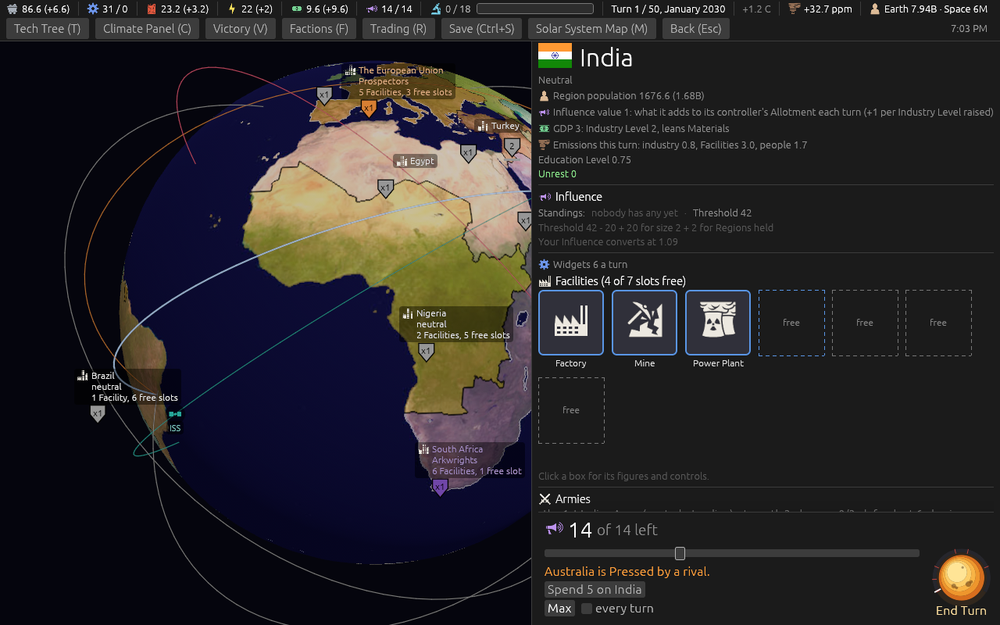

With one Region held the term is hidden ([`ticket-591/card-one-held.png`](ticket-591/card-one-held.png)).

## People in Earth orbit count for no Victory, and grow faster

Ticket [#588](https://github.com/whaleyjoshua2/Dying-Earth/issues/588), spec §12.

Grilled in three rounds. A probe first (ten games a seating): about half of every Faction's people
off Earth live over Earth -- at the end the Custodians 12.3 of 21.7, the Prospectors 10.7 of 18.5,
the Arkwrights 42.9 of 73.7, the Archivists 12.0 of 24.0. The designer took every Victory reader and
the computer's pace onto the new count, L4 and L5 counting, the bars kept for the sweep to judge,
growth an even 0.03, and the words "beyond Earth orbit". A correction owed: I asked whether an
Archive over Earth should still take Uploads; it never could stand there, not since version 0.08.1.
The designer answered by putting the Archive on the ground of another Body; a second probe found the
computer had never put it on a station anyway (40 games: the Moon 12, Mars 12, Mercury 3, Phobos 3,
none 10).

Three tests were written first and watched red (a station over Earth counted 6; ten people over
Earth still 10 after four turns; the Moon's ring took the Archive). Eleven older tests moved: six
pinned the old words, four built a station's people as the seat's Presence and now give it one on
the Moon, and the Archivists' pace test moved its Archive to the Moon's ground. The Mars race's test
(#596) moved to the Arkwrights' runner, since seed 1 now plays otherwise; **it no longer witnesses
the race weight**: the send is taken without it, and sixteen real games showed no state where only
the race weight sent a runner -- every seat reads itself behind on its people from turn 1 now, and
that lift sends the runner on its own.

The first sweep ([`sweeps/ticket-588-archivists-paced.txt`](sweeps/ticket-588-archivists-paced.txt)):
25 / 46 / 2 / 6 and 1, the Archive standing in 32 of 80 games from 60. The Archivists' computer paces
itself in people as every seat does; with the starting station uncounted it read itself behind from
turn 1, the pull a note in the code says once kept them from the Archive. Swept with their people
pace off, the Archive came back to 44 and their wins to 11; the designer took that, and kept the
Arkwrights' 42 though they fall to last in 50 of 80.

- **The sweep** ([`sweeps/ticket-588.txt`](sweeps/ticket-588.txt)): **35 / 32 / 2 / 11 and no
  collapse**. The Moon at a median turn 6, Mars at 13 (from 22), Phobos in 71 of 80, Deimos 42,
  Mercury 69, Ceres 23; people off Earth at the end a median 146 to 175 by seating.

| | Materials | Fuel | Energy | Ducats | Research |
|---|---|---|---|---|---|
| Custodians | 1,986 | 598 | 765 | 1,195 | 1,005 |
| Prospectors | 1,895 | 392 | 425 | 1,563 | 279 |
| Arkwrights | 718 | 150 | 178 | 2,533 | 233 |
| Archivists | 428 | 240 | 61 | 344 | 617 |

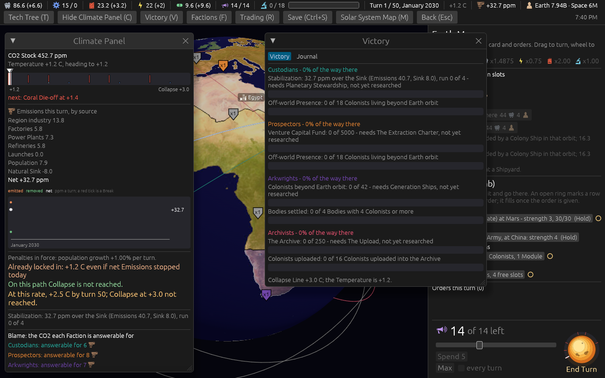

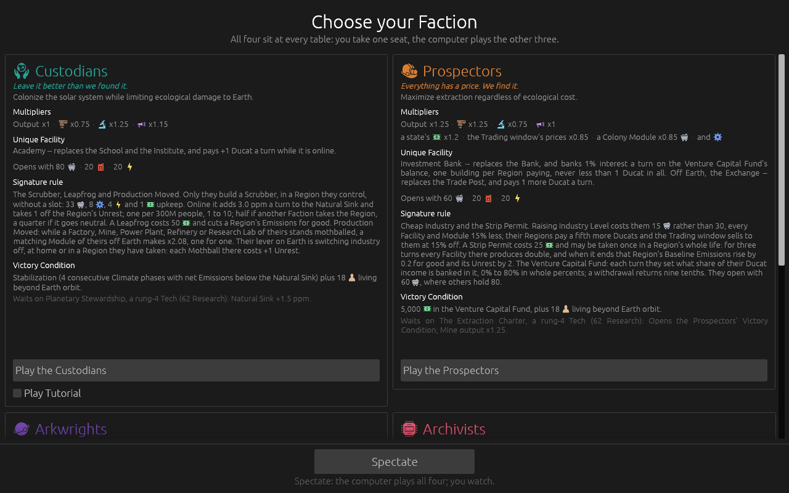

## The Region card's lines

Ticket [#598](https://github.com/whaleyjoshua2/Dying-Earth/issues/598), spec §13. One round of five
questions; the designer took each recommendation, and the line for a place not held was cut to the
held line's shape though the list named only the held one. The calm line needed nothing: #573 had
already taken it out everywhere.

No test reads these lines: the long ones were the text tool's alone and the empty row the window's.
The witness was the tool's board at seed 3 before and after (42 old lines, then none) and a picture
of Egypt's card before and after. No new term, so no glossary entry.

- **The tool's board** ([before](ticket-598/tool-before.txt), [after](ticket-598/tool-after.txt)).
- **Egypt, nobody's Standing**: "Standings: nobody has any yet · Threshold 40" before, "Threshold
  40" after. The breakdown line below it also opens "Threshold 40 - 20 + 20 for size 2", so the
  figure reads twice; it did before too, behind the cut words.

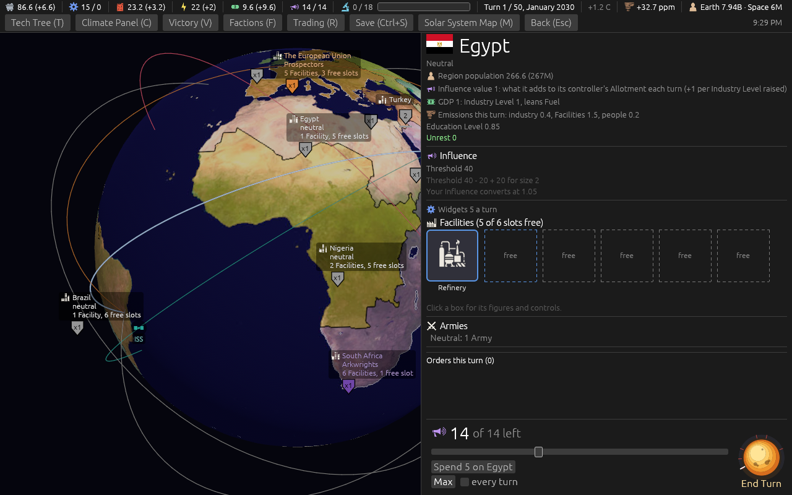

- **China, held**: unchanged, the Custodians' chip and "A rival takes it at 70".

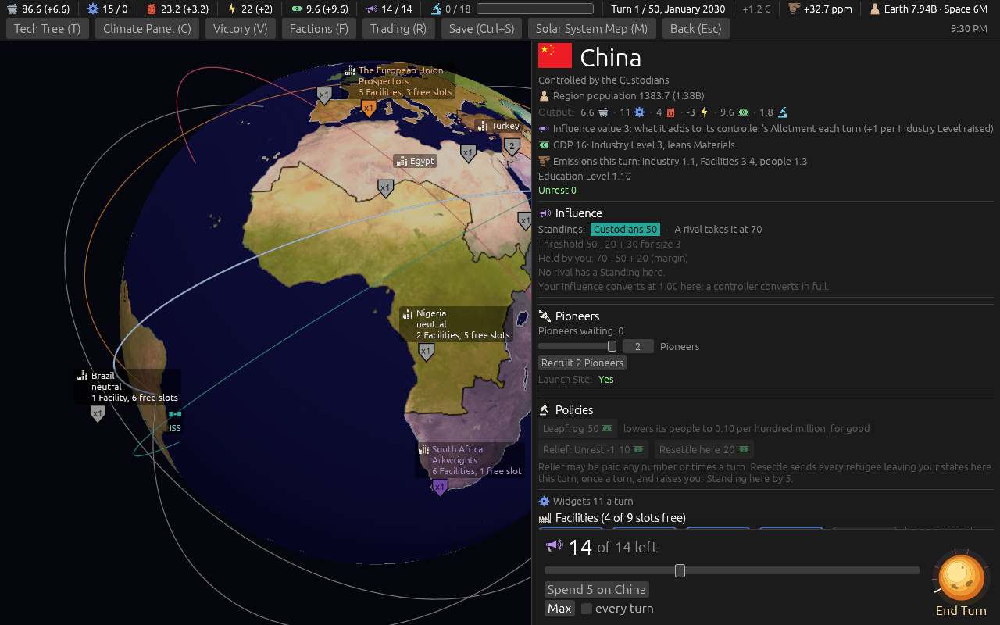

## The Custodians' Stabilization meter

Ticket [#595](https://github.com/whaleyjoshua2/Dying-Earth/issues/595), spec §14. Two rounds: the
designer took each recommendation in the first, then, with the label cut off at 1280 wide, the
Emissions glyph in place of the word.

Measured first, three seeds with the Custodians on the computer: the world's Emissions 41 at turn 1
and 70 to 90 by turn 21, the Sink 8 rising to 10 to 19 with Scrubbers, the Custodians' own 6 falling
under 1. So the bar sits a tenth to a fifth full most of a game: what it shows is how far off the
run is.

No test reads these lines: the meter is the window's and the line the tool's. The witness was the
tool's board before and after (no Custodians' line, then one), and the top bar's pictures, the
first with the word, cut off.

- **With the word**: "Emissions 41 (yours 6) · Sink 8 · run 0 of" -- the label ran off the edge.

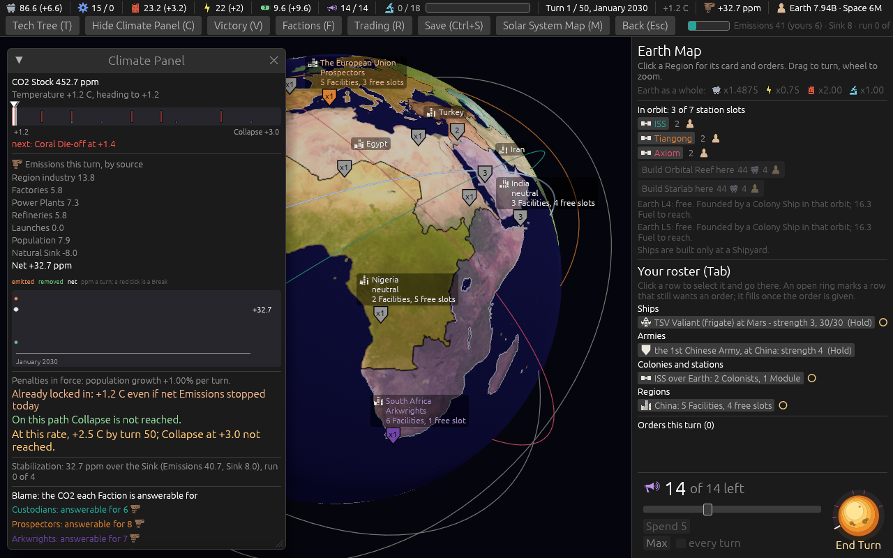

- **With the glyph**, turn 1 and turn 21:

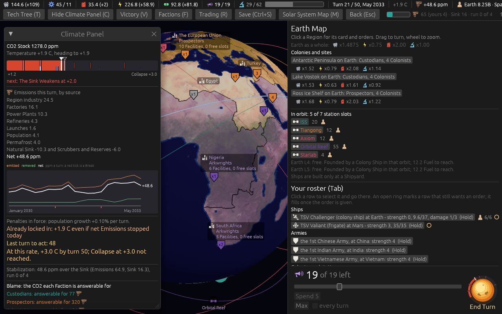

**Seen and left**: at turn 21 the top bar's first row already runs past 1280 ("Earth 8.30B ·
Spa..."), and the clock, placed from that row's width, is drawn half off the screen; the Prospectors'
bar does the same at turn 21 without this ticket.

**After the close**, the designer: *"there are too many characters cut everything back to 0/4"*.
The label is the run alone, "0/4"; the glyph went with the figures, which are the hover's. The
clock fits on the row again at turn 1.

## Turn one opens on the signature moves

Ticket [#594](https://github.com/whaleyjoshua2/Dying-Earth/issues/594), spec §15. One round of six
questions: the designer took the window, its place before the tutorial's note and the tool line;
took "their Regions" for a rival's Custodians and cut "on the Moon" from the Archivists' line; and
turned down the home Region on each row, since any Faction may start anywhere.

Two tests were written first and watched red: the four lines as each reader sees them (the field
empty), and the order of windows on turn one (the signature moves handing on to nothing where the
tutorial's note was owed). Both green after. **Signature moves** is a
new glossary entry, and the Report's entry says it is not raised on turn one.

- **The tool's new game** ([`ticket-594/tool-new.txt`](ticket-594/tool-new.txt)): the four lines,
  the player's marked "(you)", a mark I added since the tool cannot draw strong text.
- **The window**, as the Prospectors and as the Custodians ("Leapfrog your Regions", strong):

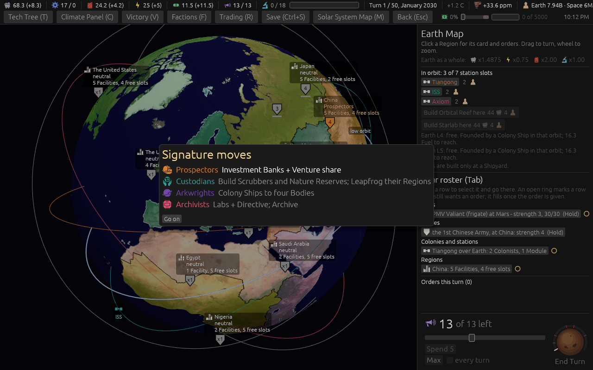

## The Upload as a story moment

Ticket [#587](https://github.com/whaleyjoshua2/Dying-Earth/issues/587), spec §16. One round of
seven questions: the designer took the line, the card's "remembered here" (with "0 remembered
here" before the first), the button's cut hover; turned down a Moment; and kept the rival
paragraph as it was. The tool's line and the naming of Colonies were not answered; I built the
recommendations (the tool reads "remembered here", and the slot name stands until Colonies carry
their own).

The test was written first and watched red (the old *"4 Colonists uploaded at Olympus Mons on
Mars: 4 in all."*), then green. The suite's word ceiling on the Report's templates then caught the
rival line's "The Archivists": Faction names have gone without "The" since ticket #463, so the
rival's line reads *"Archivists read 4 of ..."*, a departure from the wording I put to the
designer. The words stayed under the ceiling. Two shot aids were added: `uploaded:N` and
`upload:1` beside `archive:2`, and `scroll:archive` for the card's Upload row.

- **The Report** after four were read in, under Your works ("Colonies lost 1" is the staged
  Colony's, not the Upload's):

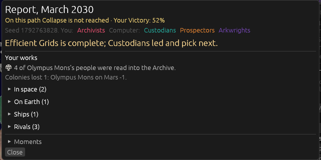

- **The card** at ten, and before the first:

- **The card after the Upload** ([`ticket-587/card-after-upload.png`](ticket-587/card-after-upload.png)):
  "4 remembered here", three living, the button offering three.

## The Colonial Capital on one slot, with eight capital buildings

Ticket [#590](https://github.com/whaleyjoshua2/Dying-Earth/issues/590), spec §17. Three rounds of
grilling: the reading of "one slot open" (the Capital stays the fourth tier; one open slot in place
of the 24 Colonists, its building in that slot), six buildings grown to eight (the Spaceport, the
Arcology), each unique in the whole game, and the names (Assay Office, Central Grid, Chancery).

Eleven tests were each watched red against a deliberate break of the rule they hold. One break
survived at first: letting a building's +1 reach a rival's Colony passed, because the test read the
rival's card, which never shows the holder's figures. The test now reads the holder's Income
(3 and 1, not 3, 1 and 1). Five older Capital tests moved to the new rule.

Two computer habits were changed. Under the old rule a Colony could build nothing more once full,
so the upgrade never competed with a Module. With one slot open it does, and the slot went to an
Exchange (34.5) ahead of the upgrade (5.0). So each seat keeps the last slot open at its Capital
site on a Body, and raises only that one. The Arkwrights' gathering built Habitats toward the
Capital's 24 people, and now builds toward the 18 the Colony tier on the way asks.

- **The sweep** ([`sweeps/ticket-590.txt`](sweeps/ticket-590.txt)): **36 / 32 / 1 / 11 and no
  collapse**, from 35 / 32 / 2 / 11 at #588, noise. **No Colonial Capital at the end of any of the
  80 games** (4 at the baseline, 2 at #588), and so no capital building.
- **With the gathering at 18** ([`sweeps/ticket-590-gather.txt`](sweeps/ticket-590-gather.txt)):
  **35 / 33 / 1 / 11 and 0**; still no Capital.
- **Why.** Traced over twenty games: every Settlement or Colony standing at the end is a station
  over Earth, which stops at the Colony tier, or a place in Antarctica. No computer place off Earth
  reached a Settlement, which wants 12 people and its 6 slots built. The Capital's own step was
  never reached, so this rule cannot move the count.

**Widened (B), at the designer's word: the computer builds up its best place off Earth.** Three
habits, each swept, each witnessed red:

| Sweep | Wins C / P / Ark / Arc | Collapses | Settlements | Colonies | Capitals |
|---|---|---|---|---|---|
| As first built ([`ticket-590.txt`](sweeps/ticket-590.txt)) | 36 / 32 / 1 / 11 | 0 | 93 | 21 | 0 |
| Raised once people fill the cap ([`cap-filled`](sweeps/ticket-590-cap-filled.txt)) | 35 / 33 / 1 / 11 | 0 | 83 | 24 | 0 |
| + the best place's upgrade x5 ([`build-up`](sweeps/ticket-590-build-up.txt)) | 35 / 32 / 2 / 11 | 0 | 96 | 20 | 5 |
| + every seat gathers ([`every-seat`](sweeps/ticket-590-every-seat.txt)) | **28 / 39 / 4 / 8** | 0 | 146 | 27 | **20** |
| Gathering without the x5 ([`gathering-alone`](sweeps/ticket-590-gathering-alone.txt)) | 30 / 40 / 0 / 9 | 0 | 154 | 19 | 0 |

The tiers count stations over Earth and Antarctica too. The gathering makes the Settlements and
lifts the Prospectors (40 with it alone); the x5 makes the Capitals. Capitals at the end of the last,
by Faction: 5 / 6 / 5 / 3. Buildings taken: Central Grid 7, Fuel Depot 3, Arcology 3, Stock Market
2, Spaceport 1. Mars still founded in 79 of 80 games, median turn 13. Income a game, mean
(Materials / Fuel / Energy / Ducats / Research): Custodians 2033 / 581 / 761 / 1202 / 1043,
Prospectors 2161 / 454 / 255 / 1510 / 336, Arkwrights 759 / 156 / 194 / 2387 / 256, Archivists
503 / 244 / 72 / 477 / 644.

- **The pick window**, the Moon's Capital unchosen and the Stock Market taken by the Prospectors on
  Mars; the bar's "Capital building" button beside the figures:

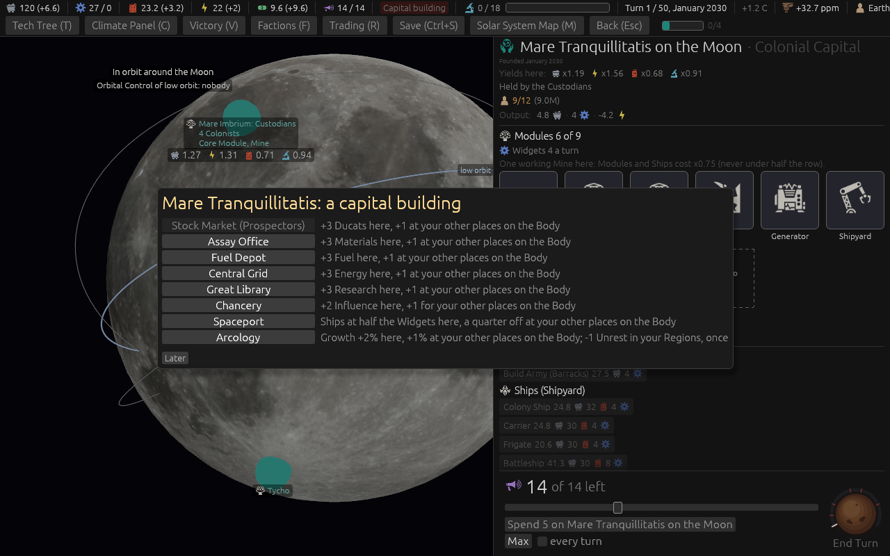

- **The card** with the Central Grid chosen: its tile in the slot it holds, "Modules 6 of 9":

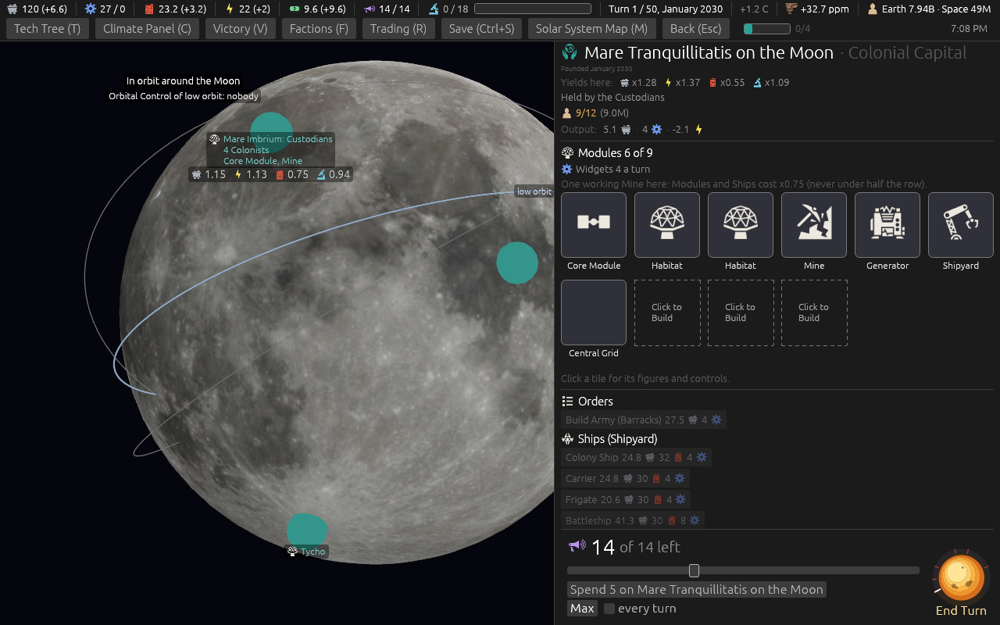
