# Version 0.1.0.6, the fission version

The map is [Map: version 0.1.0.6](https://github.com/whaleyjoshua2/Dying-Earth/issues/627); the spec
is [`docs/spec/version-0.1.0.6.md`](../../spec/version-0.1.0.6.md). The standing baseline is 0.1.0.5's
closing board, **18 / 61 / 0 / 1 and 0 collapses**
([`final-0.1.0.5.txt`](../2026-10-24-version-0.1.0.5/sweeps/final-0.1.0.5.txt)), against the designer's
15 each and 20.

## Fissionables, the seventh resource

Ticket [#628](https://github.com/whaleyjoshua2/Dying-Earth/issues/628), spec §1.

**The glyph** was chosen off a sheet, six candidates in four colours, each large and at the 16 pixels
the top bar draws, beside the Materials, Fuel and Energy it stands with:
[`ticket-628/fissionables-glyph-candidates.png`](ticket-628/fissionables-glyph-candidates.png). The
designer took **1A**, the radioactive trefoil in lime; atom-core and unstable-orb blurred at bar size
and amber would have read as Fuel.

**Rich Seam**, asked about while deciding what lifts the new figure: a one-copy Event card off Earth
that doubles every Mine on one Body for two turns, x3 with Deep Mining. The first recommendation, that
the Mine Techs should not lift Fissionables lest the Prospectors become the Fissionables Faction, was
withdrawn in the same answer: a Tech, once complete, is every Faction's. The designer's answer: the
Techs lift them, no card does, Deep Mining x1.25 and Rich Seam 1.5 and 2.

**Built test first.** Seven tests went red on their missing names before any engine code: the Bodies'
figures, the sites (forty seeds: Hellas Planitia never, the Moon two or three and both seen), the
draw leaving the game's dice alone, the Mine's figure through Deep Mining with a Discovery that does
not reach it, Rich Seam's figures, the market, and a 0.1.0.5 save loading with its sites drawn. Two
passed the first time they ran and were broken on purpose:

- **The dice.** The draw moved onto the game's own dice still passed: the pins read the slot yields
  and the deck, both drawn before the sites. A third pin, the game's next roll read from 0.1.0.5's own
  code (stashed and run), went red when the draw spent one die.
- **The load.** Taking the load's draw out turned the save test red at its first site.

Six tests that pinned Deep Mining at x1.5 moved to x1.25 (8.3 for China's Mine where it was 9.9, the
Antarctic premise computed from the card since the chain tenths once at its end). The Arkwrights'
race test had its runner already five turns out to Mars by turn 10 on this seed; the test now counts
a runner under way.

**The first picture caught what the tests did not**: the Mars Colony's Output row carried no
Fissionables, since the row is built from a list of sources the second output never reached. A test
was added, watched red (0.0 for 0.8), then the list mended.

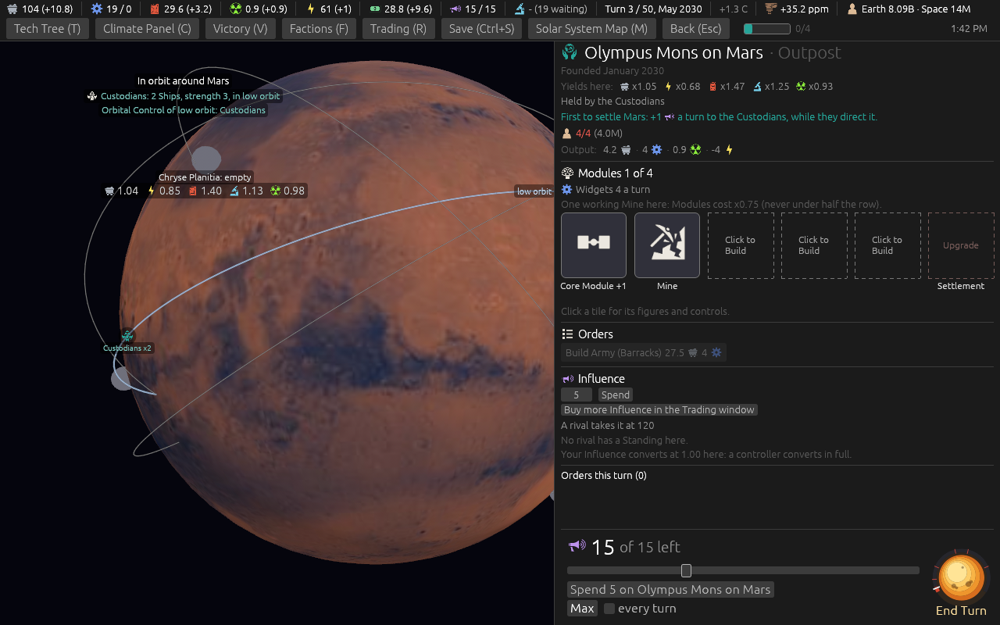

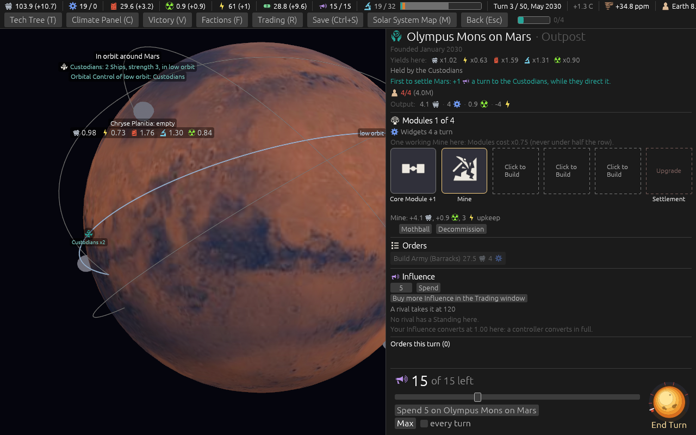

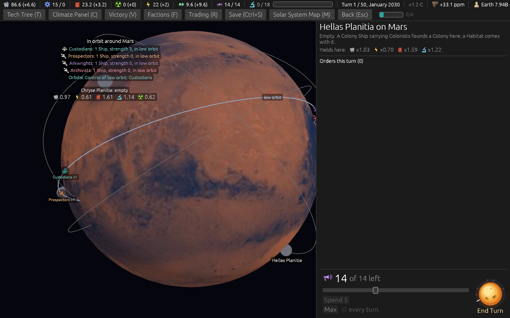

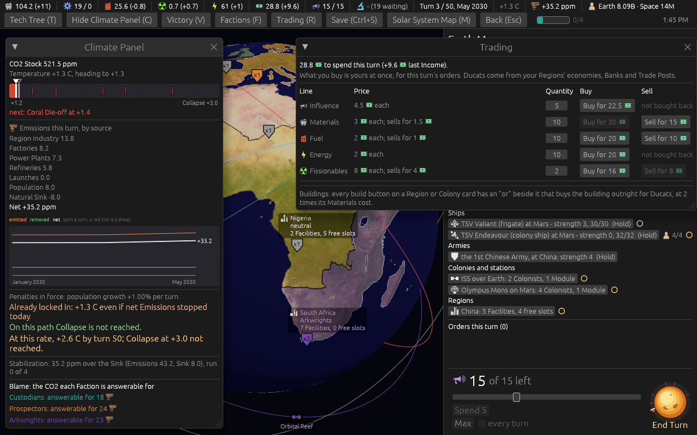

**The sweep** ([`sweeps/ticket-628.txt`](sweeps/ticket-628.txt)): **23 / 51 / 3 / 1 and 2
collapses**, from 18 / 61 / 0 / 1 and 0. Income a game, net of upkeep, by Faction:

| | Materials | Fuel | Energy | Ducats | Research | Fissionables |
|---|---|---|---|---|---|---|
| Custodians | 1,781 (2,135) | 561 (560) | 1,104 (869) | 1,270 (1,279) | 1,095 (1,135) | 56.5 |
| Prospectors | 2,046 (2,618) | 471 (503) | 578 (537) | 1,802 (1,737) | 343 (393) | 36.9 |
| Arkwrights | 721 (821) | 147 (146) | 207 (248) | 2,927 (2,826) | 314 (311) | 2.5 |
| Archivists | 400 (472) | 232 (221) | 29 (54) | 500 (527) | 727 (710) | 2.2 |

In brackets, 0.1.0.5's closing board. Deep Mining's cut took a fifth off the Materials, the Prospectors
the most, and they fell 10 wins; nothing spends a Fissionable yet, and the computer does not seek them.

**The review** (a reader who did not build it) found one rule nobody had decided: the first build let
Production Moved's x2.08 and a shut Habitat's halving reach the Fissionables, where the designer named
three lifts -- the site, the Faction's output, the Mine's Techs. A test went red (1.7 where 0.8), both
were taken off, and the sweep run again: the Custodians' Fissionables 111.7 a game to 56.5, the win
column the same to the game. Five smaller findings were mended: the Deep Core Survey's question says
*Materials*, a Trade's refusal and the text tool's help name Fissionables, a lone `f` in the text tool
is still Fuel, and the game-over table has a Fissionables column. A Mass Driver beside the Mine is
pinned not to lift them. The computer's reading of a Colony's worth leaves Fissionables out, on
purpose, until the computer is taught them.

## What Fissionables buy: the nuclear hull and the Warhead

Ticket [#629](https://github.com/whaleyjoshua2/Dying-Earth/issues/629), spec §2.

Decided in one round. The recommendation for the second fuel was a bill on the Stockpile at each leg,
no tank; the designer chose the tank (Q4 a) and set its fill as the Fuel tank's is, a share that grows
with the tank's Techs. The yard's shape -- a second button per row, *Nuclear* -- was left to me and
shown.

**Built test first.** Five tests went red on their missing names: the Tech's gate and the fill, the
leg's burn and the nuclear hull's crossing, Refuel's two tanks, the Warhead's half, and the computer's
choice. They passed when built, so the rules were broken on purpose: the hull's leg read as chemical,
the burn left in the tank, Refuel's second fill dropped. Two tests went red (the crossing and the
burn in one, Refuel in the other) and green again on restoring.

Nine older tests moved. Nuclear Rockets reaches a nuclear hull alone, so its five tests read the
Tech's turns off a nuclear hull's quote; the table's own quote -- the window hover and the Report's
window line -- is a chemical hull's, and one test says so. Four Missile Carrier tests stood their
seat on no Fissionables, so the Warhead's half was refused; each was given some. The computer's
Missile Carrier test showed the rule's other side: a computer seat with no Fissionables arms no
carrier, which the computer's chase ticket takes up.

**The first pictures caught two things.** The yard's Nuclear buttons showed Materials, Fuel and
Widgets and no Fissionables, since the button face draws its own list of figures; and every button was
greyed, the aid's Stockpile 29.6 Fuel against tanks of 30 and more. The second picture's nuclear
Frigate read *To Earth: 6 turns*: checked, a chemical hull's leg that turn is 7.

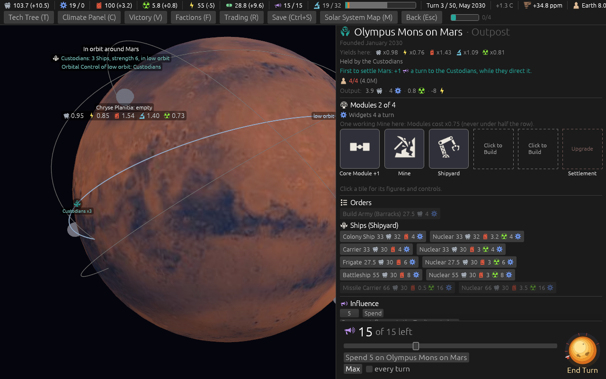

**The sweep** ([`sweeps/ticket-629.txt`](sweeps/ticket-629.txt)): **19 / 56 / 2 / 1 and 2
collapses**, from the last ticket's 23 / 51 / 3 / 1 and 2. Income a game, net of upkeep, by Faction:

| | Materials | Fuel | Energy | Ducats | Research | Fissionables | Nuclear hulls built (80 games) |
|---|---|---|---|---|---|---|---|
| Custodians | 1,806 | 572 | 1,084 | 1,266 | 1,122 | 57.3 | 95 |
| Prospectors | 2,052 | 470 | 575 | 1,821 | 350 | 32.7 | 176 |
| Arkwrights | 725 | 155 | 206 | 2,982 | 318 | 2.6 | 5 |
| Archivists | 404 | 235 | 27 | 513 | 739 | 2.1 | 2 |

Launches rose from 18 to 24 over the 80 games. Reported, not tuned.

**The review** (a reader who did not build it) found one defect the tests had missed: Refuel was
refused while a nuclear hull's Fuel tank stood full, so a hull filled when the Stockpile held no
Fissionables could never fill its second tank and never fly again, the computer's top-up refused with
it. A test went red, and Refuel now fills while either tank wants it and says which good is missing.
Four lesser findings were mended: Nuclear Rockets' line says it opens the nuclear hull; a nuclear
hull's drift line, its solar-view marker and the arrival-stranded warning read its own turns and its
Fissionables; and a change of orbit rescues a stranded hull only if it can pay its Fissionables too.
The sweep, run again, matched the first to the game.

## The Reactor and the Accumulator

Ticket [#630](https://github.com/whaleyjoshua2/Dying-Earth/issues/630), spec §3.

Decided in two rounds. The designer gated the Reactor behind Clean Power where I had recommended no
gate, asked for more names than my four, and took **the Accumulator** from seven.

**A thing I had wrong.** I told the designer the Archivists' building wore a cooling tower and that the
tower would go to the new Reactor. The candidate sheet, with the two reference pictures at its head,
showed otherwise: the Archivists' building wore the trefoil, and the cooling tower is the Power
Plant's. The decision still holds -- the trefoil goes with the name to the Reactor -- but the Reactor's
trefoil and the Fissionables glyph are now near kin, off-white on a building tile and lime beside a
figure; the Module's picture below shows both at once.

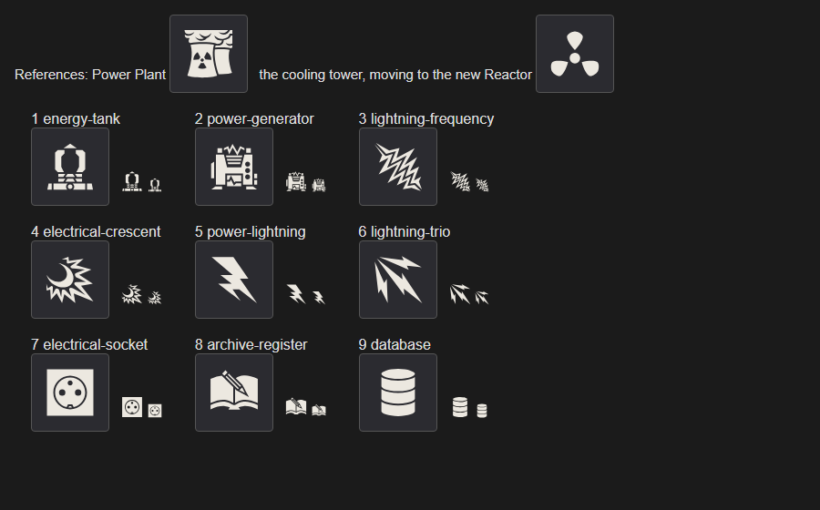

**Built test first.** Four tests went red on their missing names: the cards and the rename, the
Reactor's burn and its quarter without Fissionables, the Clean Power gate and the Module's indifference
to the sun, and the computer's ten turns. A fifth, a save naming the Archivists' `reactor` loading it as
the Accumulator, passed first. Each was broken on purpose and went red: the alias removed, the
Reactor taken out of the Energy multipliers (8 where 15), and the Fissionables left out of the upkeep
reservation (a starved Reactor burning -0.1). Five older tests moved: the Facility count, the order of
the appended kinds on both lists, and the Report's word ceiling by the nine of *Fissionables ran short*.

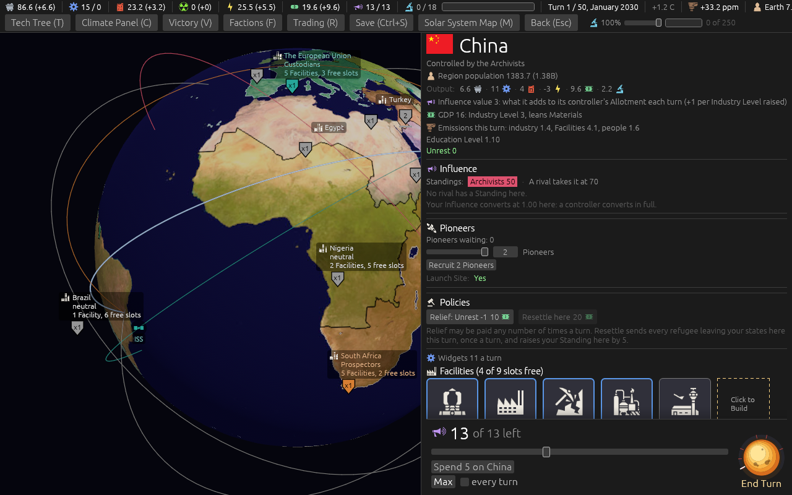

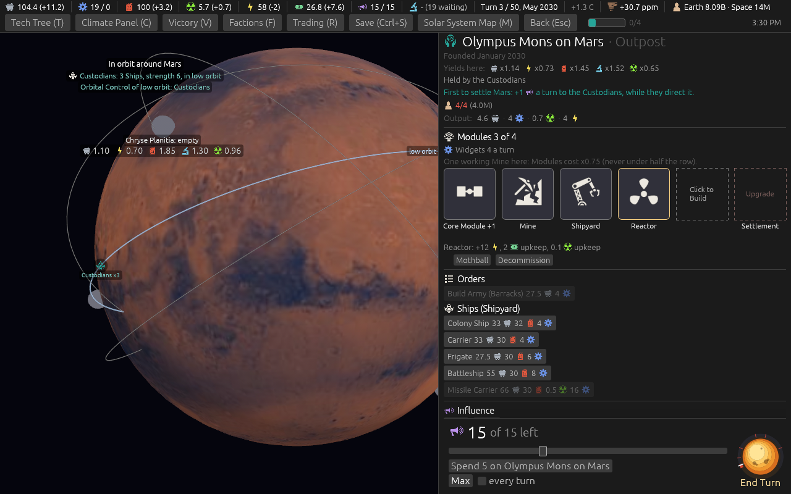

**The review** (a reader who did not build it) found one high defect and five lesser. The high one:
the computer counted a Generator's Energy and never a Reactor Module's, so a seat powered by Reactor
Modules read itself short of power for ever and went on building them -- which the first sweep's 842
Custodian Reactors fitted. A test went red (0 where 8) and the count was mended, standing and on
order. The others: the mothball shut every Reactor when only some could not be fed, and could
mothball and restart in a cycle -- now only the unfed are shut, and a restart waits for ten turns of
every running Reactor and itself (a test pins both); the Shortfall forecast read the Fissionables
before this turn's orders spent them; a dark or blockaded Reactor Module burned Fissionables it had
not reserved, which could take the Stockpile below nought; the Collapse weighting gave a Reactor no
clean preference; and a window test's fixture still said *Reactor relief*.

**The sweep** ([`sweeps/ticket-630.txt`](sweeps/ticket-630.txt)), after the mending: **28 / 47 / 1 / 1
and 3 collapses**, from 19 / 56 / 2 / 1 and 2 (the first build's read 31 / 46 / 1 / 1 and 1). Income a
game, net of upkeep, by Faction:

| | Materials | Fuel | Energy | Ducats | Research | Fissionables | Reactors standing at the end (80 games) | Nuclear hulls built (80 games) |
|---|---|---|---|---|---|---|---|---|
| Custodians | 2,231 | 630 | 1,002 | 1,118 | 1,079 | 88.9 | 699 | 158 |
| Prospectors | 2,205 | 512 | 866 | 1,628 | 360 | 40.9 | 431 | 170 |
| Arkwrights | 727 | 158 | 207 | 2,798 | 290 | 5.5 | 53 | 17 |
| Archivists | 397 | 234 | 35 | 504 | 707 | 1.1 | 4 | 0 |

The Custodians rose nine wins and stand the most Reactors, about nine a game; the Prospectors' Energy
rose by half (575 a game to 866) and they fell nine. Launches 12, from 24. Reported, not tuned.

## The computer chases Fissionables

Ticket [#643](https://github.com/whaleyjoshua2/Dying-Earth/issues/643), spec §4. The designer's aside on
the Fissionables ticket, charted then: *"we need to teach the computer to chase this resource but that
might be better after its uses are built out."*

Decided in two rounds; Q5 and Q6 came back after a first sweep run on Q1 to Q4 alone.

**Built test first**, every test red on its missing names or its figure first. The buy test went red on
behaviour: the computer had spent its Ducats on Influence before the turn's end, where the Buy stood,
so the Buy moved to the head of the turn. Two were broken on purpose after passing: the site worth's
Tech gate and the Mine lift's reserve check.

**The review** found eight things. The worst: the sale kept two tanks where the nuclear build gate wants
a fill and two more, so a seat sold the Fissionables it was saving for a hull. The keep now covers the
gate, and every Reactor standing, mothballed or on order, which a restart had been selling out from
under itself. A Trade asked for the same shortfall the Buy had paid for, and crowded out every other
Trade while the seat could not pay; a partner gave away its own reserve; the Buy was all or nothing;
the sale had no price floor; and units offered in a Trade could be sold the same turn. Each is mended,
two with tests that went red first.

**The sweep** ([`sweeps/ticket-643.txt`](sweeps/ticket-643.txt)): **22 / 56 / 1 / 1 and 0 collapses**,
from the Reactor's 28 / 47 / 1 / 1 and 3. By Faction, over the 80 games:

| | Fissionables a game, net | Bought | Sold | Reactors standing at the end | Nuclear hulls built |
|---|---|---|---|---|---|
| Custodians | 97.4 | 43 | 3,776 | 705 | 164 |
| Prospectors | 55.8 | 110 | 1,144 | 490 | 210 |
| Arkwrights | 5.7 | 39 | 45 | 96 | 19 |
| Archivists | 2.0 | 2 | 25 | 1 | 0 |

The Custodians mine the most and sell most of it; the Prospectors build the most nuclear hulls (181 to
210 once the keep stopped selling their savings) and won nine more. The Archivists stand one Reactor in
eighty games. Reported, not tuned.

## Standing ferry routes

Ticket [#631](https://github.com/whaleyjoshua2/Dying-Earth/issues/631), spec §5. The designer: *"Standing
ferry routes for colony ships that return to a specified orbit - takes its people and return. should
include auto refuel and button to enable should give a indication of round trip fuel requirements"*.

Decided in three rounds. The designer loosened what a Colony keeps from its Habitats' room to one
Colonist per Module built, added waiting for a window, and gave the computer routes.

**Built test first**, then each rule broken on purpose to watch its test fail: eleven at the build and
four from the review. One test caught a real fault on its first run: a Ship in flight kept its count
of turns waited at home.

**The first picture** caught the gate pricing a Mars route at this turn's leg, 43.2 Fuel against a
tank of 32, when it waits for a window whose leg fits: **Set route** was greyed. Each leg is priced on
the turn it would leave now, with a test that is red on the old pricing. The route's arrow, ⇄, drew
as an empty box; ↔ draws.

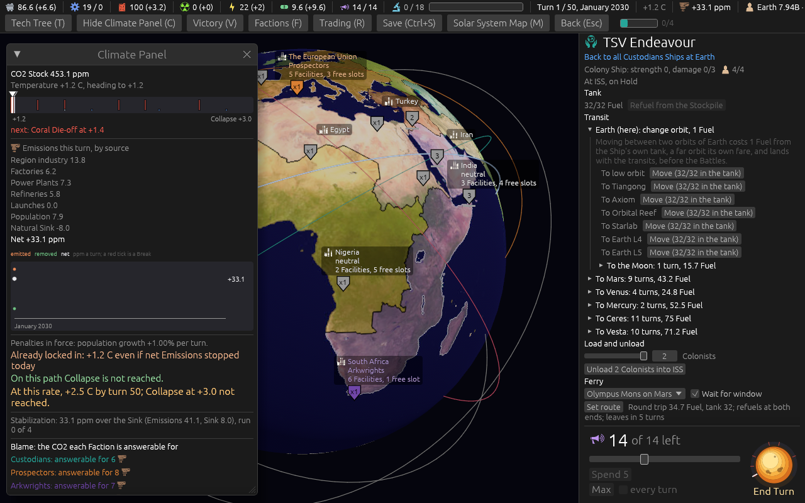
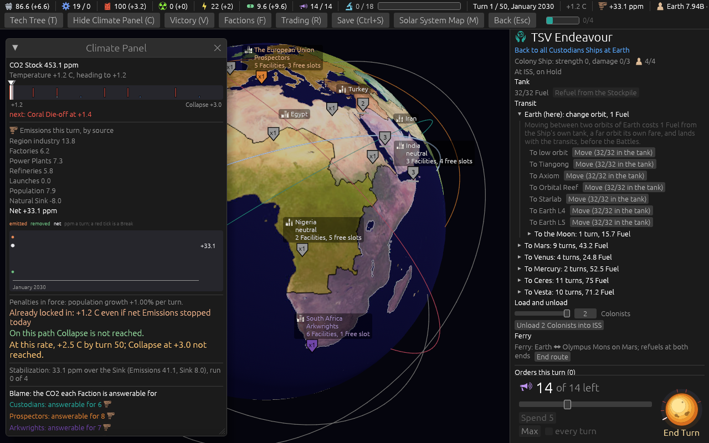
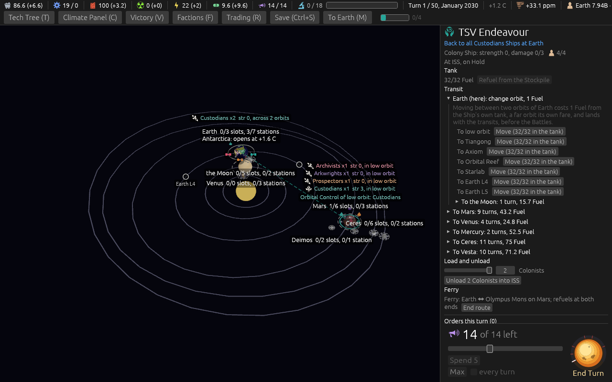
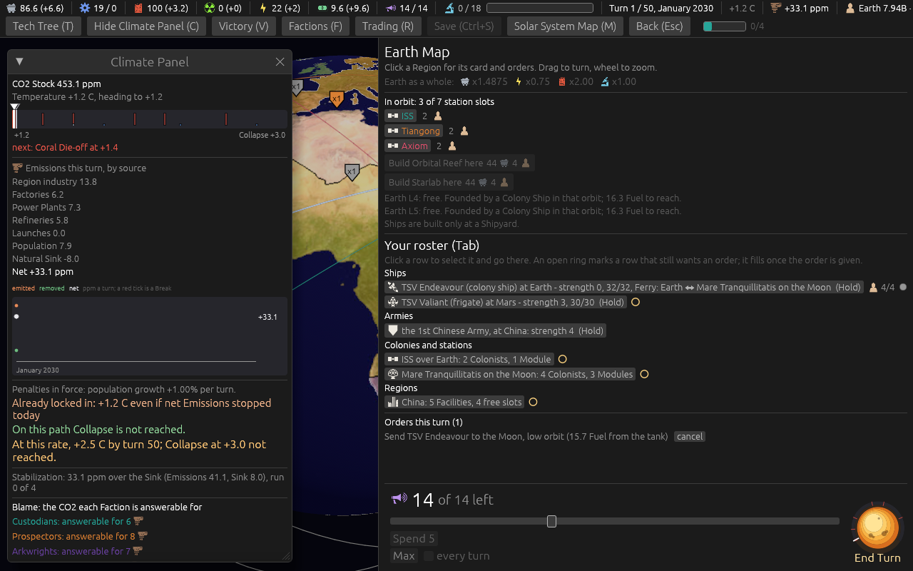

**The review** found six things. The computer would have turned a flight meant to found a second ground
Colony into a route to the first, since low orbit touches both. The card never said which end refuels.
An Earth home ring lost to a rival never ended the route, and a route could be set from a rival's
ring. A route between two orbits of one Body neither refuelled nor checked it could get back. A routed
Ship still counted as the planner's runner. A home with no depot passed the gate on a tank that could
not fly the first leg. Each is mended, the four in the engine with tests that went red first. Of the
minor points: a delivery of nobody is no ferry's; a flight refused for another reason is no Fuel wait;
the turn's head places nothing for a spectator; the reason a route cannot be set is in words; and the
card's picks belong to one Ship.

**The sweep** ([`sweeps/ticket-631.txt`](sweeps/ticket-631.txt)): **22 / 55 / 2 / 1 and 0 collapses**,
from 22 / 56 / 1 / 1 and 0. By Faction, over the 80 games:

| | Routes set | Colonists ferried | Deliveries | Materials | Fuel | Energy | Ducats | Research | Fissionables |
|---|---|---|---|---|---|---|---|---|---|
| Custodians | 1 | 6 | 1 | 2,217 | 633 | 989 | 1,071 | 1,056 | 97.6 |
| Prospectors | 8 | 29 | 5 | 2,187 | 507 | 864 | 1,606 | 343 | 55.8 |
| Arkwrights | 7 | 12 | 1 | 732 | 159 | 186 | 2,771 | 299 | 6.7 |
| Archivists | 18 | 132 | 23 | 400 | 244 | 40 | 504 | 701 | 2.0 |

The six goods are each Faction's income a game, net of upkeep. The Archivists run the most routes;
34 routes in 80 games is few, and why was not measured. Reported, not tuned.

## The Faction figures

Ticket [#638](https://github.com/whaleyjoshua2/Dying-Earth/issues/638), spec §6. Decided in one round: the
designer's *"Archivists start with 50 fuel and their transit modify for fuel is 0.8 ..."* is the
Arkwrights' line, the 50 Fuel with it; the Archivists open with 25 Ducats; the Fund is 6,500.

**Built test first**: one test pinning every new figure and the card's words, red on the old data.
Twenty-three older tests pinned the old figures and were moved to the new, each with its ticket; four
were renamed, since their names stated the old rule (*an Arkwright habitat holds twelve*). One fixture
needed more than a figure: the Arkwrights' station of five Habitats held 34 at half again and holds 29
at a quarter again, under the 32 its premise puts aboard, so it has six.

I quoted the designer 870 / 2,168 for the pace; x6500/6250 rounded as ticket #623 rounded is 867 /
2,167, which is what stands. My first card text said a Colony Ship carries 10 and 15 with the Techs;
the Techs add two each to a Colony Ship, so it is 7 and 10. The new test carried the same mistake;
it was caught while moving the older Colony Ship test, whose arithmetic reads 7.

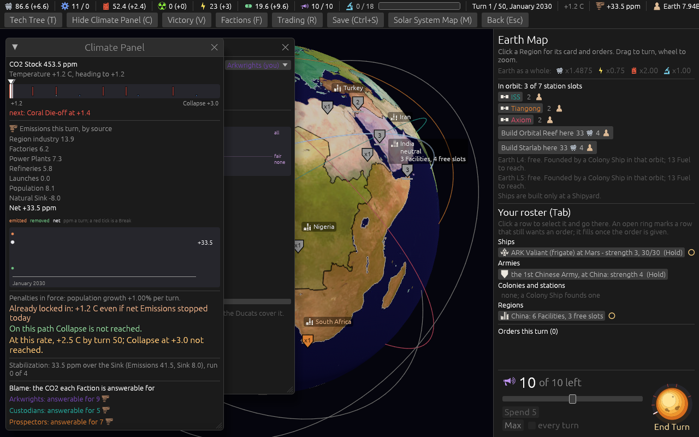
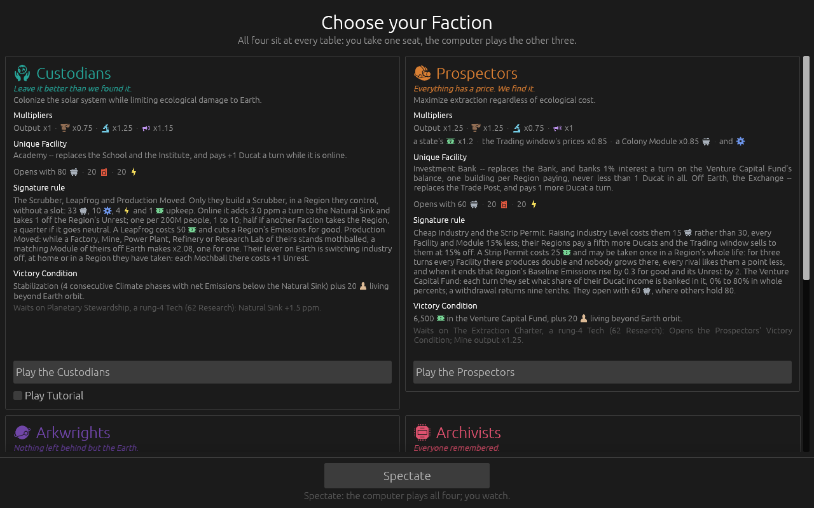

**The sweep** ([`sweeps/ticket-638.txt`](sweeps/ticket-638.txt)): **30 / 46 / 1 / 3 and 0 collapses**,
from 22 / 55 / 2 / 1 and 0. Each Faction's income a game, net of upkeep:

| | Materials | Fuel | Energy | Ducats | Research | Fissionables |
|---|---|---|---|---|---|---|
| Custodians | 2,360 | 682 | 1,045 | 1,066 | 1,193 | 73.6 |
| Prospectors | 1,841 | 455 | 636 | 1,579 | 270 | 62.2 |
| Arkwrights | 674 | 110 | 221 | 2,677 | 266 | 0.8 |
| Archivists | 438 | 258 | 25 | 592 | 717 | 2.4 |

**The review** found no figure or sum wrong. It found words: the Exodus Call still said it ran *at the
ordinary cost in people* in the order list, the Report, the log and the text tool's help, a saving that
no longer exists, and is cut; the glossary's opening figures and Habitat entry, two doc comments and
three test names still told the old figures, and are moved.

The Prospectors fell nine and the Custodians took them; the Arkwrights lost the one they had gained.
Reported, not tuned.

## The first child born off Earth

Ticket [#633](https://github.com/whaleyjoshua2/Dying-Earth/issues/633), spec §7. Decided in three rounds;
the designer asked *"can we give the arkwrights a small push on this?"* and chose the computer's
push: its Arkwrights chase Habitats and landings beyond Earth orbit a quarter harder until somebody
has the first birth.

**Built test first**, red on its missing names, then five rules broken on purpose to watch their tests
fail: the line beyond Earth orbit, once a game, the tie, the chase being the Arkwrights', and its end.

**The picture** took three runs. The Moment stood behind three Accord offers on the first, then behind a
drawn card; the aid answers both now, and with `menus:1` the Report picture opens on the Moment.

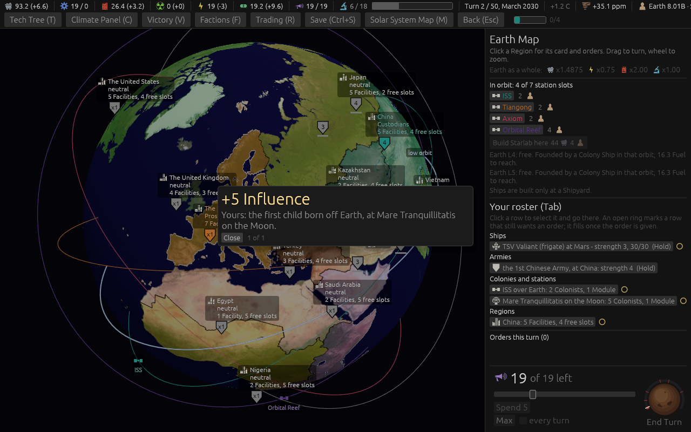

**The review** found nothing that blocks. The +5 sat last among the Allotment's parts and the hover
shows six, so a seat with six parts already never saw it; it is second now, with a test that is red
on the old place. The chase now checks the Colony is the seat's own rather than trusting its callers,
the Report line is marked as the player's work, and a test that picked "not the Arkwrights" by seat
number picks by Faction. Kept as it is: a save from before this version, loaded after a birth off Earth
has happened in it, will award the Moment at the next one.

**The sweep** ([`sweeps/ticket-633.txt`](sweeps/ticket-633.txt)): **31 / 45 / 1 / 3 and 0 collapses**,
from 30 / 46 / 1 / 3 and 0.

| | First child born off Earth (games) | Materials | Fuel | Energy | Ducats | Research | Fissionables |
|---|---|---|---|---|---|---|---|
| Custodians | 29 | 2,398 | 686 | 1,056 | 1,074 | 1,214 | 75.5 |
| Prospectors | 22 | 1,855 | 454 | 626 | 1,600 | 269 | 63.2 |
| Arkwrights | 16 | 676 | 107 | 207 | 2,611 | 263 | 1.5 |
| Archivists | 13 | 447 | 260 | 26 | 631 | 719 | 3.4 |

The goods are each Faction's income a game, net of upkeep. There was no count of first births before
this ticket, so the Arkwrights' 16 has nothing to be set against. Reported, not tuned.

## The Refugee Convoy sent to the stars

Ticket [#632](https://github.com/whaleyjoshua2/Dying-Earth/issues/632), spec §8. Decided in one round: six
people, a point of Unrest for taking them in, and the third answer as the ticket drew it.

**Built test first**, red on its missing names; six rules then broken on purpose to watch their tests
fail. A choice card had two answers wired through the engine, the computer, the window and the text
tool; the third is general, a card's own button with its own effects and rule.

**The first sweep caught a fault**: the computer sends the convoy only when its room holds all six,
yet it lost 50 refugees. The room was read at the answer and the lift made at the Resolution, by
which time the turn's own flights had taken the Ships away. The designer's words were *lifted at
once*, so the lift is made when the answer is given, into the room the button showed, and the
Unrest and Report line land at the Resolution. A test flies the Ship off after the answer; the
next sweep lost nobody.

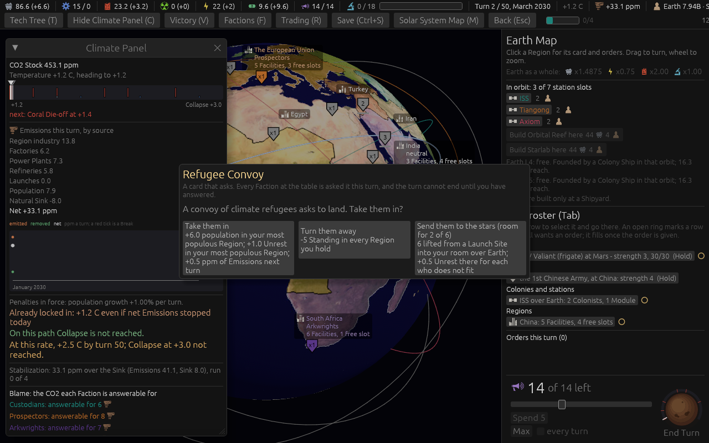

**The review** found nothing that blocks. Mended: the lift prefers a Region with a Spaceport, so the
Arkwrights are paid for it as for any lift, and the line says what the Spaceport paid; a lift of
nobody is no launch; the loader refuses a third answer without its button or effects, two lifts on a
side, or a room rule larger than the convoy; the answer is said in the Report before what it did;
the `cardanswer:` shot aid takes `third`; and two texts that said a card has two sides say less.
The sweep's took / refused counts do not count a third answer; the convoys sent stand for it.
Left as it is, for the designer: the refugees board knowing the neutral Education, not the Launch
Site Region's, since they were never its people.

**The sweep** ([`sweeps/ticket-632.txt`](sweeps/ticket-632.txt)): **30 / 46 / 1 / 3 and 0 collapses**,
from 31 / 45 / 1 / 3 and 0.

| | Convoys to the stars | Materials | Fuel | Energy | Ducats | Research | Fissionables |
|---|---|---|---|---|---|---|---|
| Custodians | 5 | 2,404 | 685 | 1,052 | 1,067 | 1,215 | 75.7 |
| Prospectors | 7 | 1,864 | 460 | 619 | 1,601 | 271 | 64.0 |
| Arkwrights | 12 | 674 | 108 | 207 | 2,600 | 262 | 1.5 |
| Archivists | 5 | 452 | 260 | 31 | 648 | 718 | 3.5 |

The goods are each Faction's income a game, net of upkeep. Reported, not tuned.

## A Colony card's threats line

Ticket [#634](https://github.com/whaleyjoshua2/Dying-Earth/issues/634), spec §9. Decided in one round; the
designer took a loaded Carrier and the Ships bound for the Body as threats too, and the roster's mark.

**Built**, the engine's line shared by the card, the roster and the text tool, then each rule broken
on purpose: seven, and an eighth after the first run showed the order rule was tested by luck --
by the time the station was read, an Accord had removed the only other threat, so its own ring was
first either way.

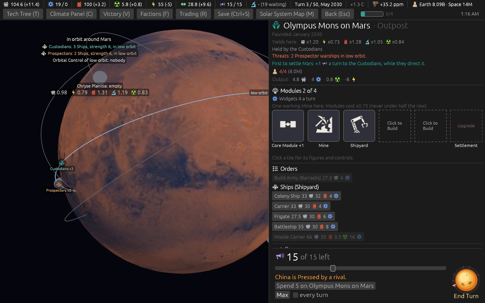
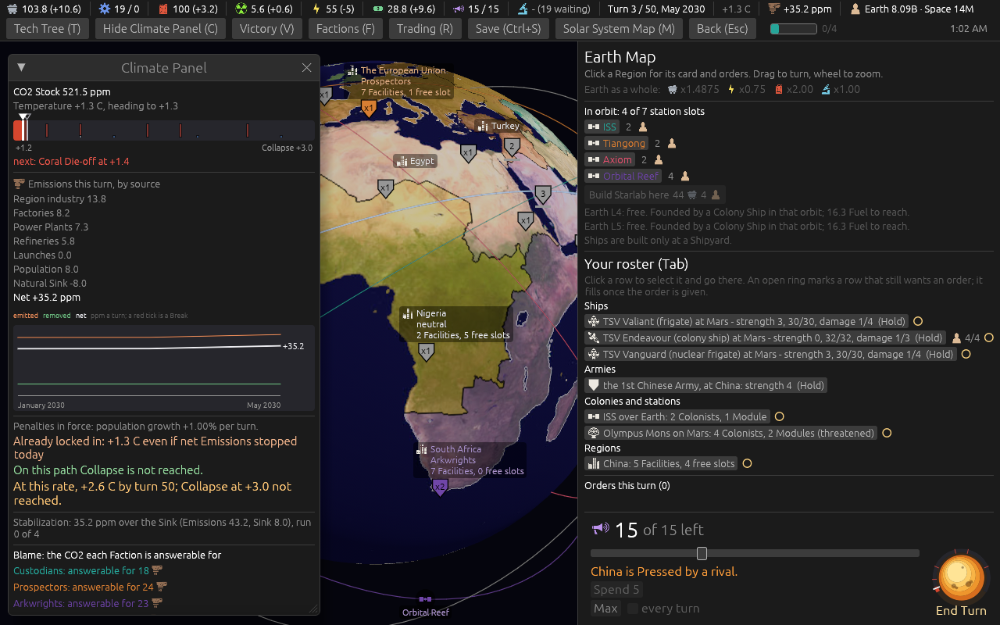

**The review** found eight. The worst two: an Occupied Colony's line was read for its occupier, so the
player's own warships and Standing were called its threats; and on a rival's card the player's own
Ships were named. The line now speaks for the holder, and shows on the player's own places only (every
seat's when spectating). Mended besides: a seat's arrivals name warships and Armies apart; Carriers
in one orbit are one entry; the hover gives a loaded Carrier's Army strength; a fled Ship is no
threat; the card reads the threats once a frame. Each with a test that went red on the old code.
Left for the designer: an armed Missile Carrier over the Colony is not named, since the game's
`warship` is a Frigate or a Battleship.

**The sweep** ([`sweeps/ticket-634.txt`](sweeps/ticket-634.txt)): **30 / 46 / 1 / 3 and 0 collapses**,
identical to the convoy's, as a change to what is read and not to what is done should be.

## A new Army joins its stack's stance

Ticket [#635](https://github.com/whaleyjoshua2/Dying-Earth/issues/635), spec §10. The ticket came in as
Barracks that raise and repair their Garrisons on their own, and the first round asked about that.
The designer: *"I don't want barracks to be stealing people and resources to just endless build
armies in the background. The note from the playtester was about newly built armies sitting idle
when built rather than reinforcing the stack that is there."* The ticket was rewritten to that and
decided in a second round.

**What was wrong.** Every Army came into the game on Hold. Beside a dug-in stack the newcomer fought
without the +2, beside an attacking one it stood, and the card's stance row, which reads the first
Army, still said the stack's stance.

**Built** in `raise_army`, the one door every Army comes through. Each rule broken on purpose: the
joining, the own-side filter, the tie to the first raised, the most-held count; each went red. One
older test (the computer massing a stack, ticket #322) had dug in China's own Army to keep it out and
then raised two Armies it expected free to march; they now joined the dig-in, so the fixture puts
them on Hold.

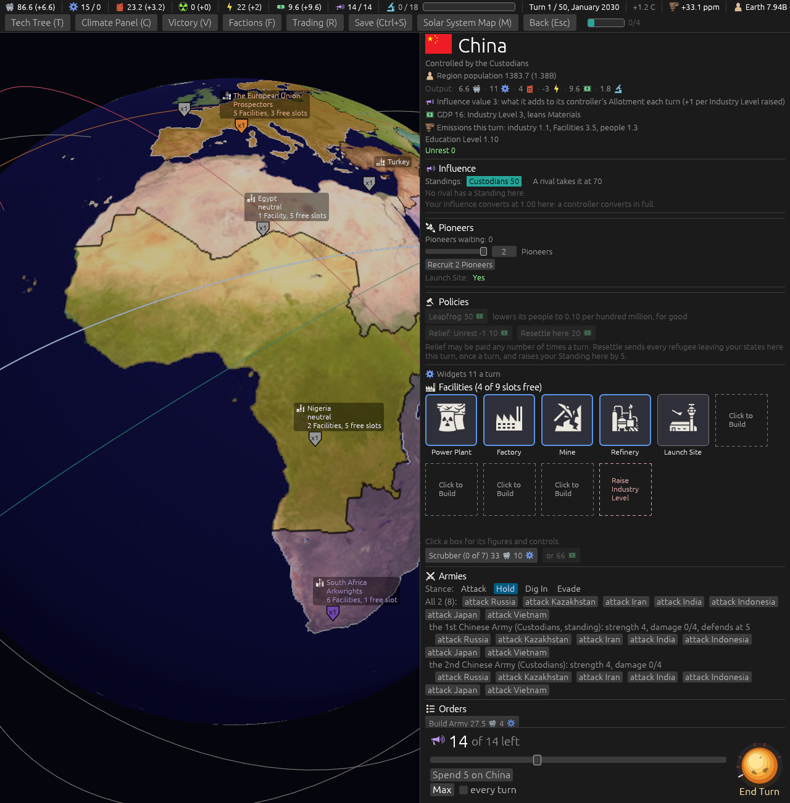

**The review** found no defect in the rule as decided. Mended: the tie rule's doc comment claimed the
newcomer always takes the card's stance, which a tie between two later stances belies; and Q2's
restraint is now tested (a dug-in newcomer refused a march, red when the refusal is removed). Left for
the designer: a computer seat orders Dig In at a home with an enemy near every turn, so its new
Armies there, which used to stand one turn on Hold and could march with a stack, now stay; and the
Standing Army's return joins the stack too, which Q1 did not name.

**The sweep** ([`sweeps/ticket-635.txt`](sweeps/ticket-635.txt)): **30 / 47 / 0 / 3 and 0 collapses**,
from 30 / 46 / 1 / 3. One game moved, seed 5 with the Prospectors seated first, from the Arkwrights to
the Prospectors.

## An inherited Army stays on Hold until its holder orders it

Ticket [#636](https://github.com/whaleyjoshua2/Dying-Earth/issues/636), spec §11. The designer had
asked *"didn't we fix this awhile ago"*: 0.1.0.0 did, for one turn. Reading the code turned up two
things the ticket's draft did not know: a Region's holder can never open a Battle in their own Region,
so an Army left on Hold there is a squatter nobody can fight (the designer accepted that, Q3 a); and
standing in a rival's Region cost no Relations, as the draft supposed. Decided in one round. The
order that ends the peace is a march, a boarding, or Attack or Evade, never Hold, since *I ordered
Hold and it attacked* would be the same complaint again.

**Built.** The grace's one-turn clock is gone; the orders clear it. Tester 2's game kept no save, so a
test builds it: three quiet Resolutions, no Battle, a reminder each turn.

**The review** found the boarding cleared at the order, while a load waiting on the cargo step boards
after the ground Battles: the Army was put on Attack and fought first, the tester's complaint again.
It now clears where the Army boards. Q4 had reached any other seat's Army in the Region, a third
seat's besiegers and a completed Occupation's defenders among them; narrowed to the previous holder's.
The reminder skips an Army its holder dug in by order; two stale comments. Tests added for boarding,
marching, the narrowed Q4 and the reminder; six rules broken on purpose, each red, the first being the
review's fault restored. Left for the designer: the review reads `ai.rs` as never marching an Army
home, so a computer seat's inherited Army may wait abroad for good; not measured.

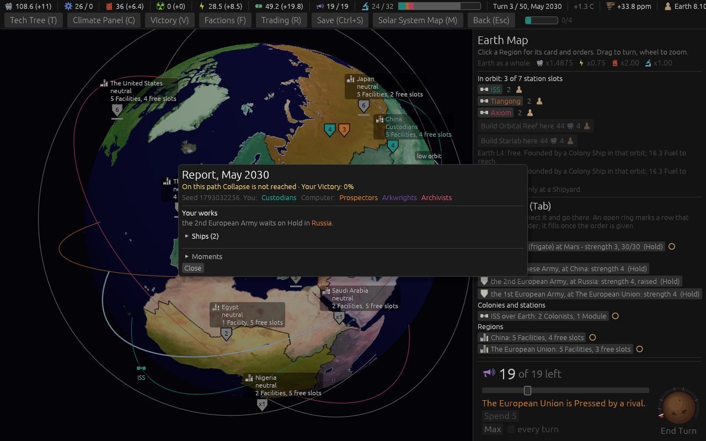

**The sweep** ([`sweeps/ticket-636.txt`](sweeps/ticket-636.txt)), after the review's mends: **29 / 48 / 1 / 2
and 0 collapses**, from 30 / 47 / 0 / 3, with fewer Battles in every seating: 37 from 42, 102 from 110,
38 from 39, 26 from 27.

## Scrapping a Colony Ship into the Colony below

Ticket [#637](https://github.com/whaleyjoshua2/Dying-Earth/issues/637), spec §12. The draft offered half
a hull's Materials or a Module of up to its price, for any hull. The designer cut it to one thing: an
empty Colony Ship becomes a free Habitat; the tank is lost. Decided in two rounds.

**Built**: a Scrap order whose checks are the Habitat build's own, so the slot cap and a station's
list come for free, and the Habitat takes its slot among the turn's other builds. The computer reads
a new record of when each Ship was first found stranded. Eight rules broken on purpose, each red; the
eighth (a rescued Ship's count starting afresh) went green at first, and a test was added for it.

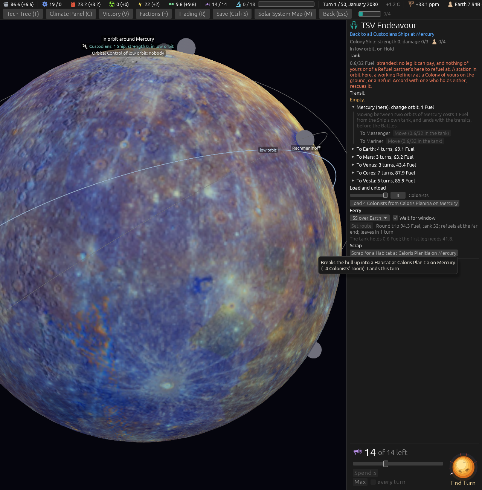
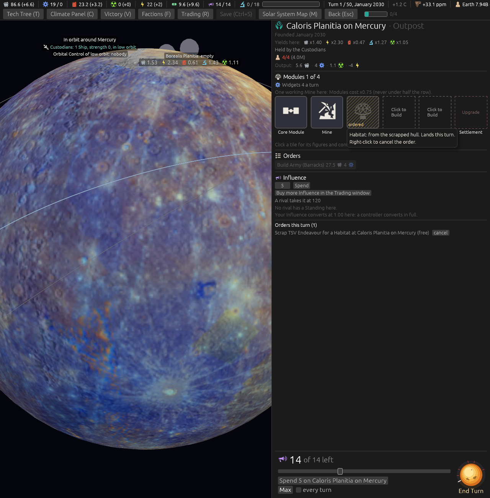

**The review** found no rule broken. Mended: a Scrap stood beside a Set route on the same hull, which
left a route for a Ship that no longer existed, and beside a Refuel or a Load, paid for and lost;
each now refuses the other. The Colony grid drew the Habitat as a Widget build (*0 of 0*, *N Widgets,
X turns*); it now reads *from the scrapped hull. Lands this turn.* A rival's scrap is seen where the
Colony is. Tests for the station ring, an Army aboard, transit, a slot taken this turn, the tank lost
and the computer leaving a hull with people aboard; three more rules broken on purpose, each red.
Left for the designer: the Scrap lands when the orders are committed, before the turn's Battles, so
an empty Colony Ship about to be destroyed can become a Habitat instead.

**The sweep** ([`sweeps/ticket-637.txt`](sweeps/ticket-637.txt)): **32 / 45 / 1 / 2 and 0 collapses**,
from 29 / 48 / 1 / 2; 153 Colony Ships scrapped, and the Ships stranded at the end fell from 244 to 109.

## Refitting a chemical hull as a nuclear one

Ticket [#644](https://github.com/whaleyjoshua2/Dying-Earth/issues/644), spec §13, a ticket the designer
added to this version mid-way. Decided in one round. One fact moved the draft: a Rearm does not hold
its carrier, so a refit holding its hull in orbit would have been a new rule; the designer took the
Rearm's (Q4 a).

**Built** as a build item in the yard's queue beside the Warhead, landing on the hull wherever it is.
The computer's refit is a pass after its chosen orders, so a hull refits only when nothing else
wanted it -- or so the comment said. Eight rules broken on purpose, each red. The picture's first
take showed the build template's *0 Materials* first line; it now names the Fissionables.

**The review** found the computer's refit placed BEFORE its candidates, not after: it took the
hull's one action, so a Frigate the planner wanted at Mars stayed home refitting, and it spent
Fissionables a nuclear build wanted. Moved after both candidate loops, and kept off a hull on a ferry
route or given a load, a refuel or a route; refits over the batch fell from 116 to 33. Mended besides:
a Scrap on a hull with its refit queued threw the Fissionables away (refused now); the second tank was
not capped at the tank when the refit landed; the card dropped *refit under way* while the hull flew.
Three more rules broken on purpose, each red.

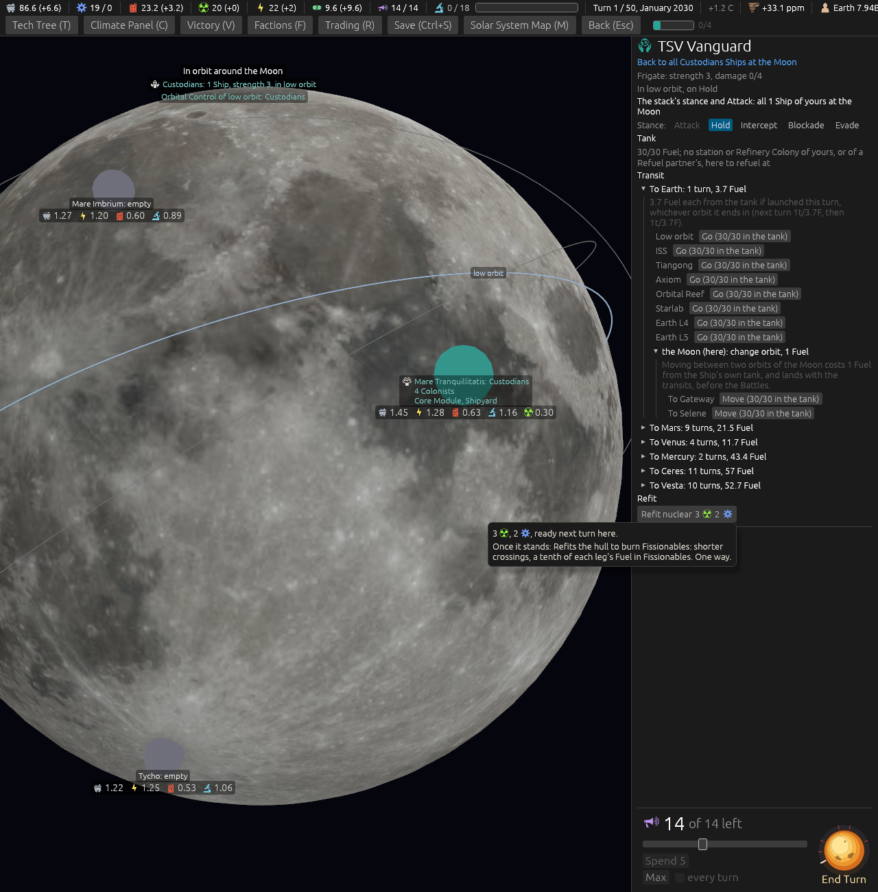

**The sweep** ([`sweeps/ticket-644.txt`](sweeps/ticket-644.txt)), after the review's mends: **32 / 45 / 1 /
2 and 0 collapses**, the same wins as #637's; 33 hulls refitted, nearly all the Prospectors' and
Custodians'.

## Two more Nation States, and the climate swept with them

Ticket [#639](https://github.com/whaleyjoshua2/Dying-Earth/issues/639), spec §14. The draft offered
Pakistan and Korea; the designer chose Canada with Greenland, and Ethiopia with the Horn. Three
rounds. Two facts reshaped the draft: a Nation State is cut out of another's ground, so it adds no
people and moves the climate only by its own card; and "climate sweep" meant, the designer said,
"find a step that optimizes" -- the `ppm_step` re-sweep every board change has had.

**Built.** The flags fetched from flag-icons, as every flag but Vietnam's and Argentina's was; the
Natural Earth borders fetched for the run and not kept. Before the change the generator redrew the
committed mask from that file to the pixel (0 of 2,097,152 differ), so the new mask's change is the
split's alone: 81,326 pixels from the United States' to Canada's, 4,888 from South Africa's and 392
(Eritrea) from Egypt's to Ethiopia's, nothing else.

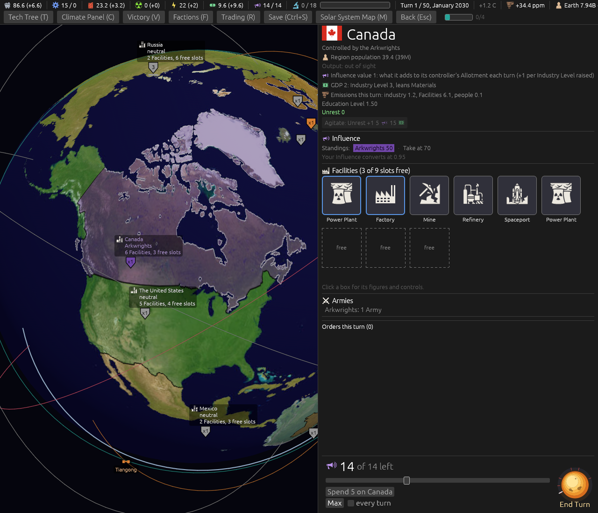
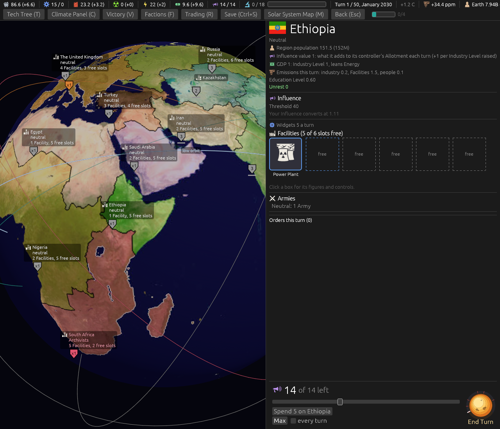

**What moved under the tests.** Fourteen failed on the new board, and each was read:
- **Counts** (twenty-two, 60 coastal slots, Influence 37, the United States worth 6) and the
  parents' pools.
- **Canada's start card** broke the rule a Mine stands beside every start Factory; it now follows it.
- **A computer seat now opens in Canada**, an untouched Industry 3, where the fourth seat had opened
  in Australia. Asked (Q11), the designer kept it. Three tests that named Australia, or the seat
  there, were moved to the new seats.
- **Seeded states re-pinned:** a Lab's yield (the United States' smaller people), the dice after the
  start, the race to Mars (seed 1 on turn 16 now) and the Relations game, which parts on turn 8, not
  7. Nobody buys a credit within it now, so what parts the boards is another of Relations' readings,
  not traced.

**The review** found no defect, and three re-pins weaker than they read. The Relations test asserted
a credit refusal that no longer happens in it; the computer seats' orders were traced turn by turn,
and what parts the two games now is that the hostile seats Smear one another and propose no Accord,
which the test now asserts (red when the hostile game is made neutral). The dice pin is called a
snapshot of this version, which it is. The race re-pin hid what the Canada start did to the
Arkwrights; over 80 games at the same step (620): Opening Objectives met 27 where 17, first to Mars
12 where 17, wins 4 where 1 -- mixed, not the cost the first seating alone suggested. Stale comments
mended.

**The step sweep**: 620 0 collapses, 560 2, 500 5, 440 9, 380 19, 320 32; set at 380. The standing
sweep at 380 matches the cell figure for figure.

**The sweep** ([`sweeps/ticket-639.txt`](sweeps/ticket-639.txt)): **35 / 25 / 1 / 0 and 19 collapses**,
from 32 / 45 / 1 / 2 and 0. The collapses are where the designer asked; the win column is not.

## Art for the eight capital buildings

Ticket [#640](https://github.com/whaleyjoshua2/Dying-Earth/issues/640), spec §15, a prototype ticket.
Thirty-two game-icons.net candidates, four a building, chosen for each one's job and none already
on the board (three Spaceport first choices were the Spaceport's, the Launch Site's and the Colony
Ship's own and were swapped out), drawn large and at tile size in a capital's gold edge. The first
sheet was the `icon_sheet` example's one long row, unreadable at a glance; it was redrawn as a grid
of eight rows, and the first message about it pointed at a file on this machine the designer could
not see. It went up on the throwaway branch `prototype/640-capital-art` instead. The designer took
the recommended seven and the artificial hive for the Arcology (*"I'd like the Arcology to be
8d"*), which also keeps the habitat dome -- the Habitat Module's own icon -- off a second tile.

**The review** found the Spaceport's pick, the moon in orbit, is the Arkwrights' own symbol: the
sheet's duplicate check had compared the files' bytes, and the game's copies differ from a fresh
download, so it passed. The designer's second choice, the spaceship, was the warship's for the same
reason; thirteen more were screened against the credits list, which names every icon in use, and
the defence satellite chosen. The review also found the gold edge turned grey under the pointer, as
every tile's edge did; at the designer's word it now brightens instead.

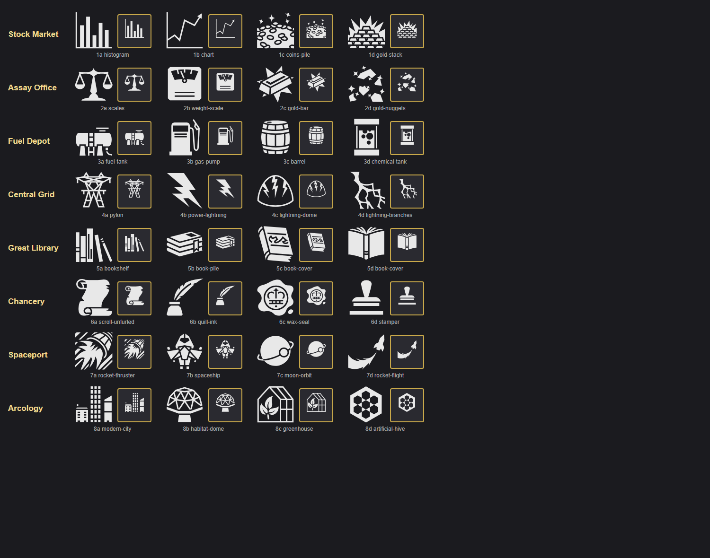

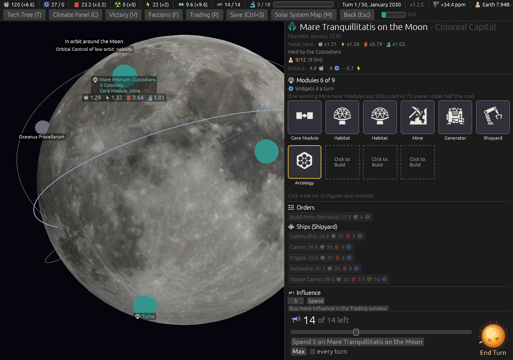

**The sweep** ([`sweeps/ticket-640.txt`](sweeps/ticket-640.txt)) is identical to #639's.
